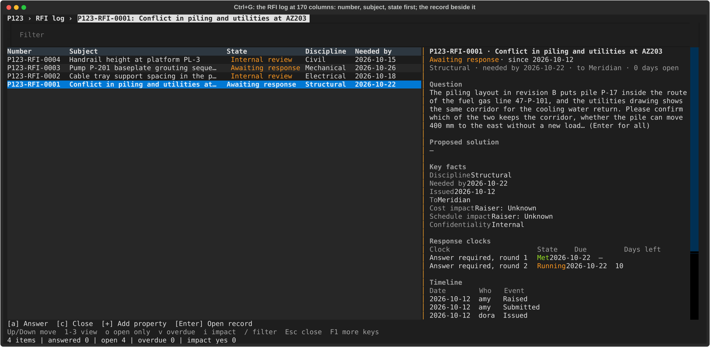
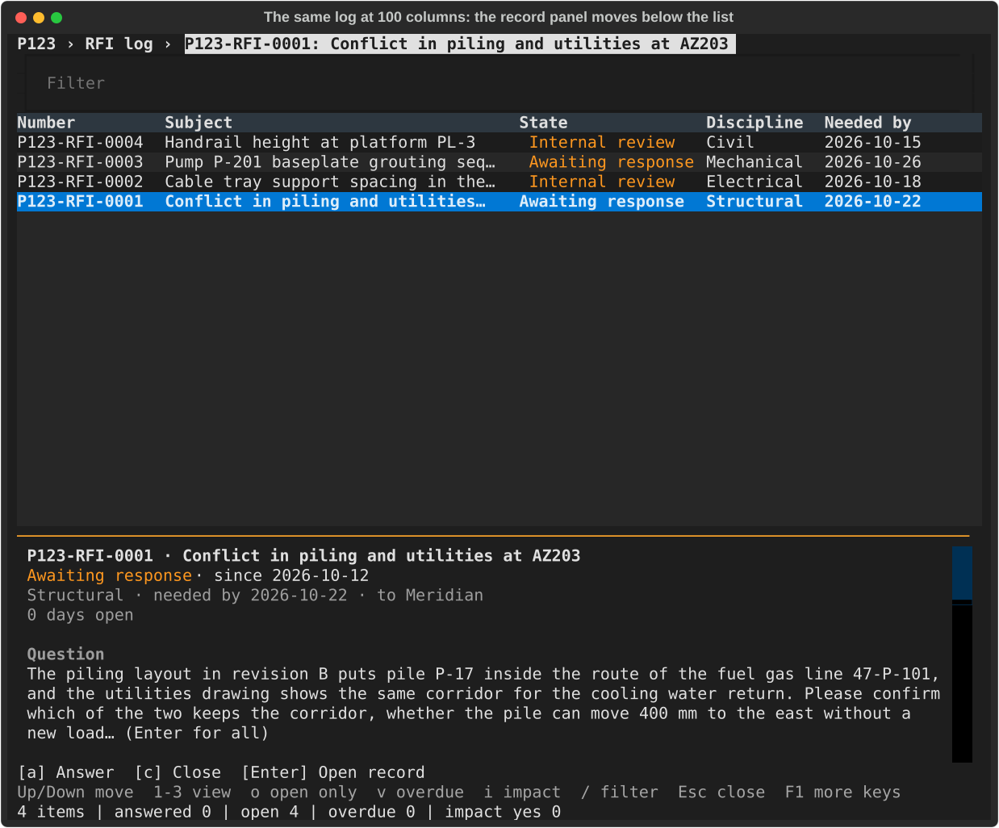
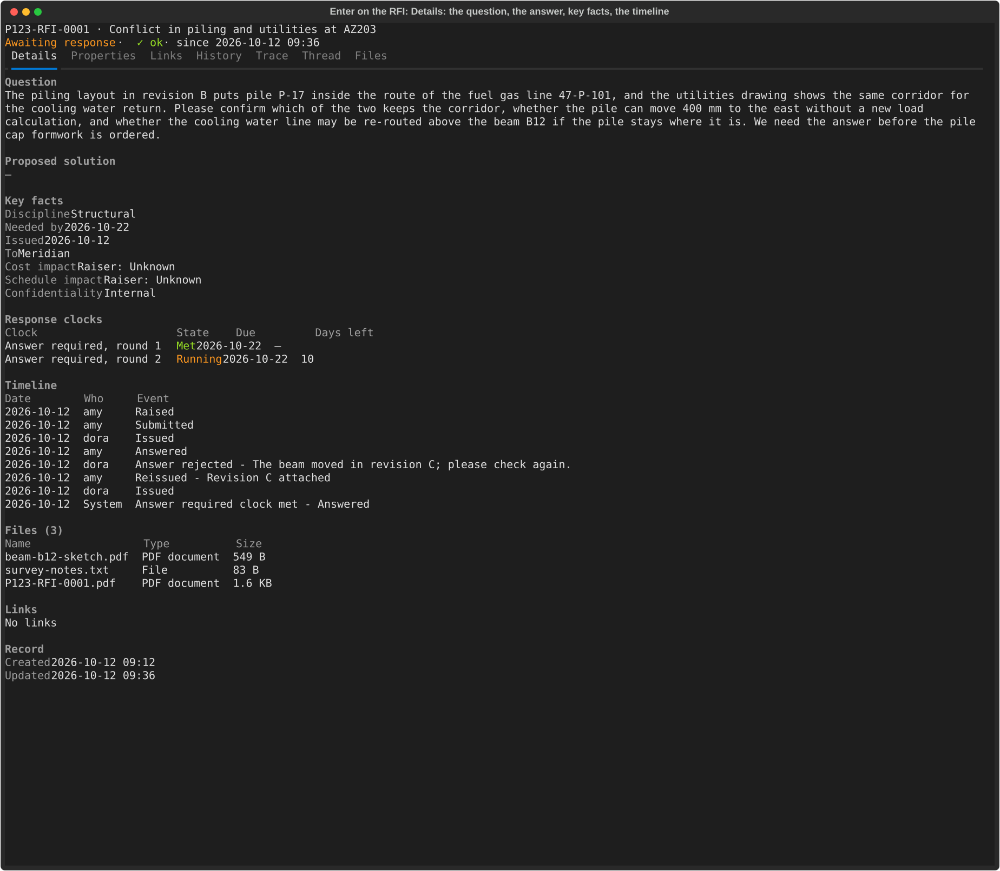
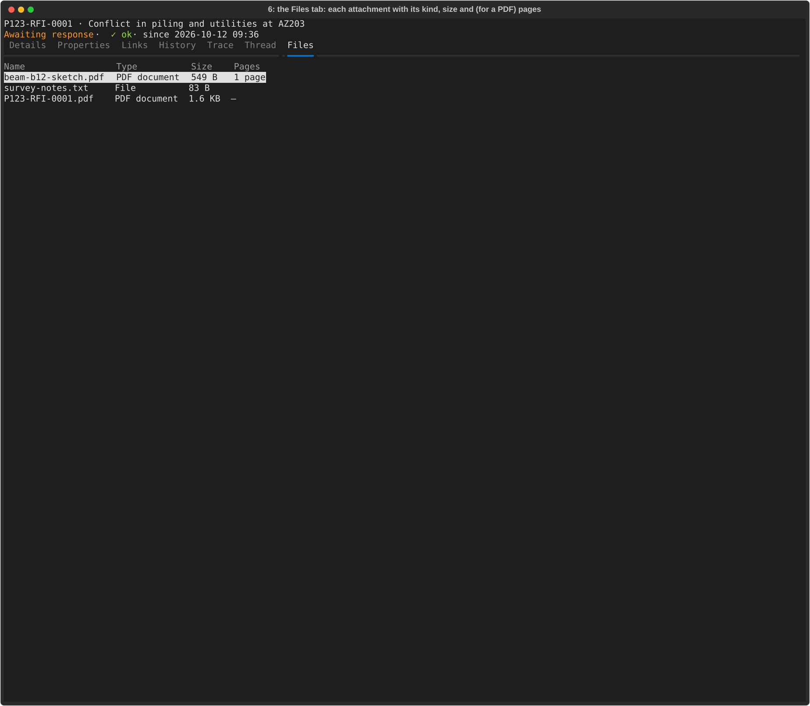
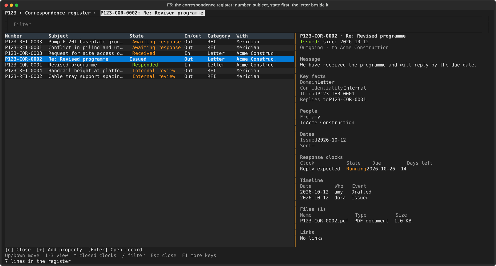
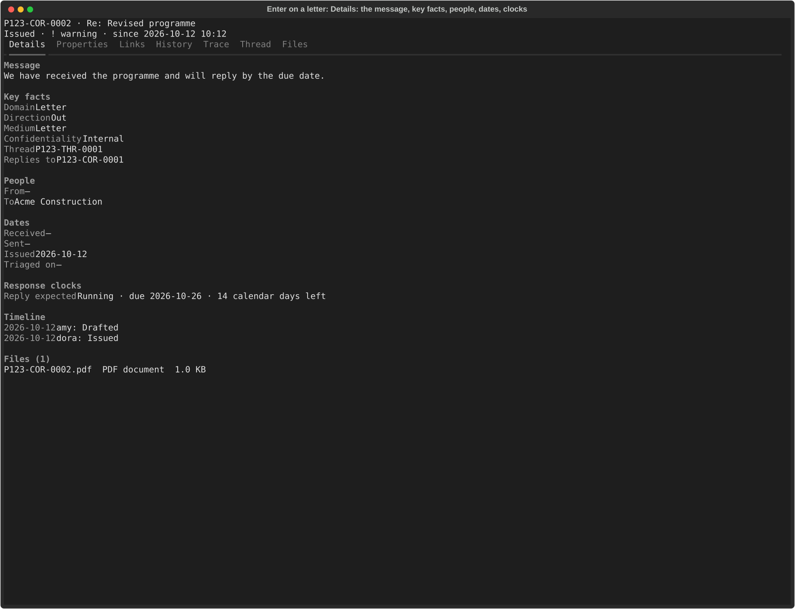
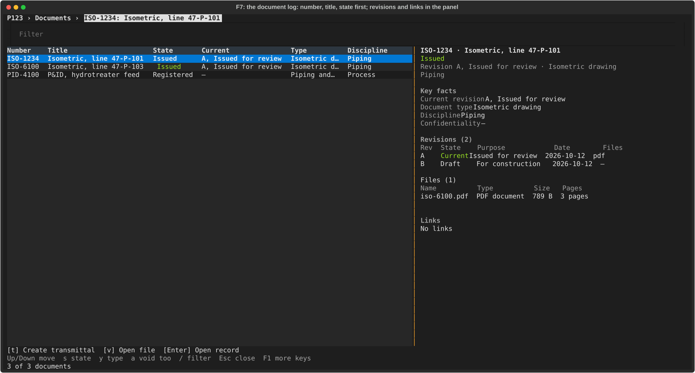
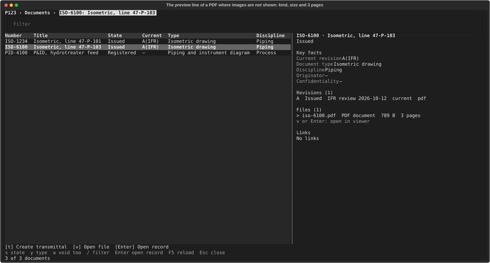

# Highlights: the everyday screens

Eight screenshots of the screens people use most: the RFI log, an RFI, the correspondence log, a letter and the document log. They are generated: `just tour highlights` (`uv run python dev/tour/highlights.py`) builds a small made-up project (four RFIs in different states, a few letters, three documents, the company standards loaded), drives the real terminal UI headless and writes the SVG files under `tour/highlights/`. The clock is frozen, so a second run changes no file. The full tours are [PHASE-0-TOUR](PHASE-0-TOUR.md) and [PHASE-1-TOUR](PHASE-1-TOUR.md); the layout rules these screens follow are in the `tui-layout` skill.

Each screen reads the same way: where you are, which record, what state, then the detail in named sections. The identity line (`number · subject`) and the state come first, then a summary line of the three or four facts a person decides by; every other value is a `Label  value` line, and anything that repeats (a list of revisions, response clocks, files, links, the timeline) is a small table with a dim header row. Only fields that can apply to this kind of record are shown (a letter we sent has no "Received" date), an applicable but empty value reads `—`, and codes read as words (`A, Issued for review`). The state is coloured (green done, amber waiting or running, red overdue or refused) and always written out, so it reads in monochrome too. The ids and keys the system uses inside are shown only to an admin who switches technical details on (Ctrl+D). Round 2 of the layout work (P1-UX3) added the summary line, the tables, the colour and the one-line keys row; the rules are in the `tui-layout` skill.

## 01 RFI log, wide

The list shows the number, the subject and the state first, then the fields people scan by (discipline, date needed). A column that is the same in every row, such as the kind (always "Request for information"), is left out until two kinds appear. The selected RFI sits to the right: under its state, a summary line (discipline, date needed, who it is with, days open), then its question, the key facts, the response clocks as a small table (the two rounds of one clock are told apart: "Answer required, round 2") and the start of the timeline. The keys row is one line: movement, the log's own filters, Esc and F1; every other key is on the help screen.

## 02 RFI log, stacked

On a narrower terminal the same record panel moves below the list. Only the subject is shortened (with `…`) to fit; the rest of the record is a key away (Enter). The keys row still fits one line.

## 03 An RFI's Details

Enter opens the record. The Details tab reads top to bottom: the question in full, the proposed solution, the key facts, the response clocks and the status timeline (oldest first, with who and why) as small tables, the files (name, type, size), the links and when the record was made. Extended properties are on the Properties tab, not here.

## 04 The RFI's Files tab

Key `6` lists the attachments as a small table with their type, size and, for a PDF, the page count; Enter or `v` opens the selected file in the system viewer (the actions bar says so, so the panel no longer repeats it as a hint).

## 05 The correspondence log

The register lists every letter, email and register item with number, subject and state first, then in or out, a short category (RFI, Letter, Transmittal) and who it is with. It is shown at 170 columns: where the eight columns would not fit without scrolling sideways, the least needed (the due date, then the date) are left out and the name of the other party shortens before the subject does. The selected letter shows a summary line (outgoing, to whom, when a reply is due), its message, the key facts, who it is from and to, the dates that apply to a letter we sent, the reply clock, the timeline, the files and the links.

## 06 A letter's Details

The letter's record leads with the message, then the key facts (the medium only when it differs from the kind of letter), the people (the drafter for a letter we sent), the dates (an outgoing letter has no "Received" or "Triaged on"), the response clock, the timeline, the files and the links. The delivery state and other plumbing are technical details.

## 07 The document log

Documents list the number, title and state first, then the current revision in words ("A, Issued for review"), the type and the discipline. The panel shows a summary line, the key facts, the revisions as a table (revision, state, purpose, date, files; the current one marked), the files of the current revision and the links, with a stale link marked `!`.

## 08 The document preview line

Under Files the panel gives the file's kind, size and page count; in a terminal that can show images it draws page 1 instead (the tour's terminal cannot, like the tests). `v` opens the file.
