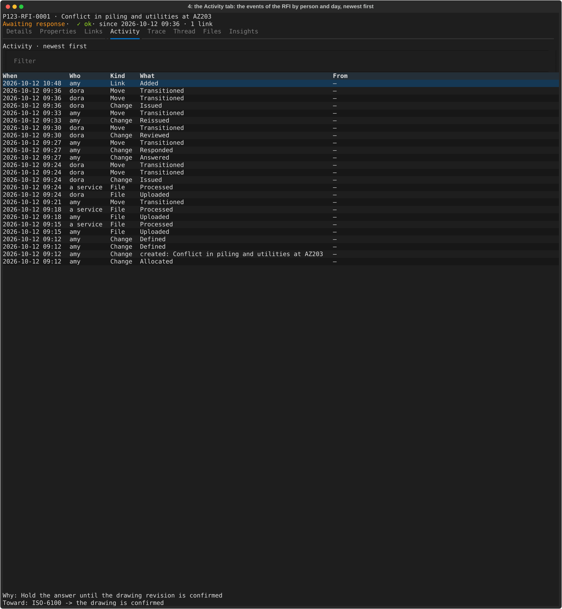
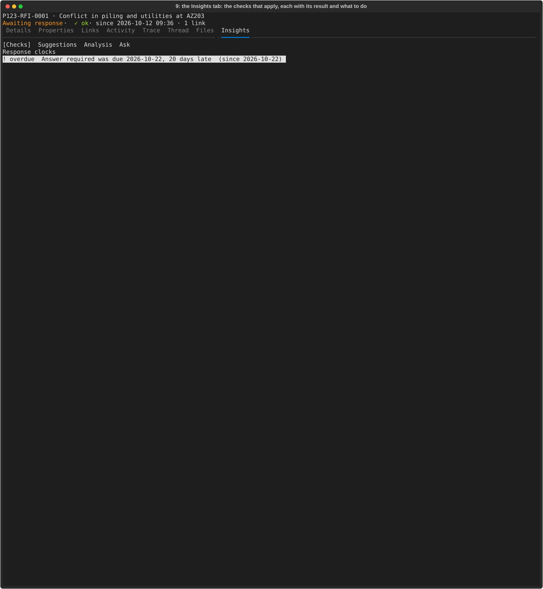
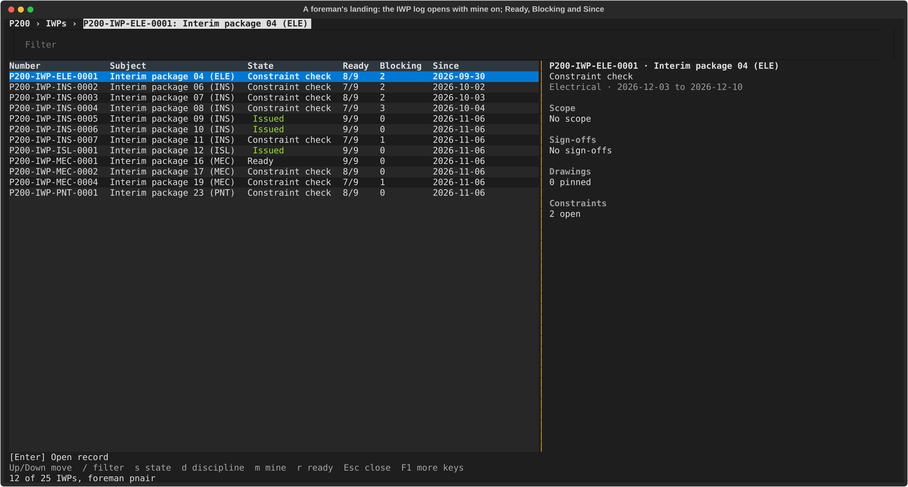
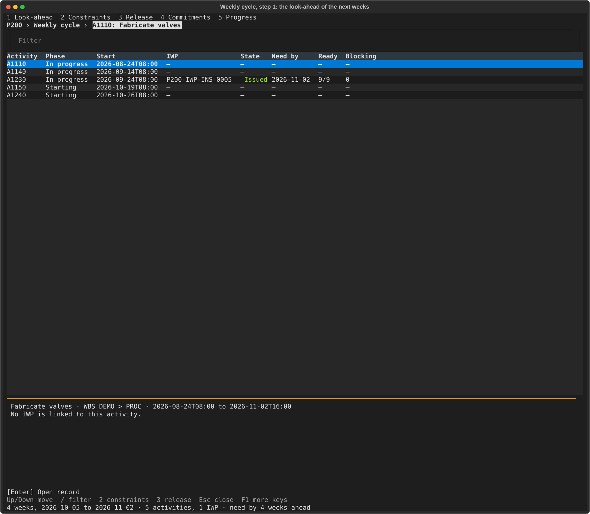
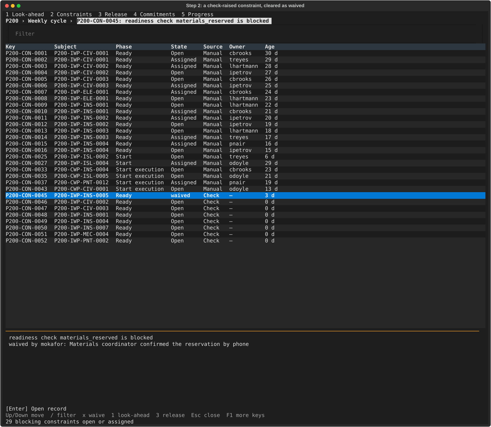
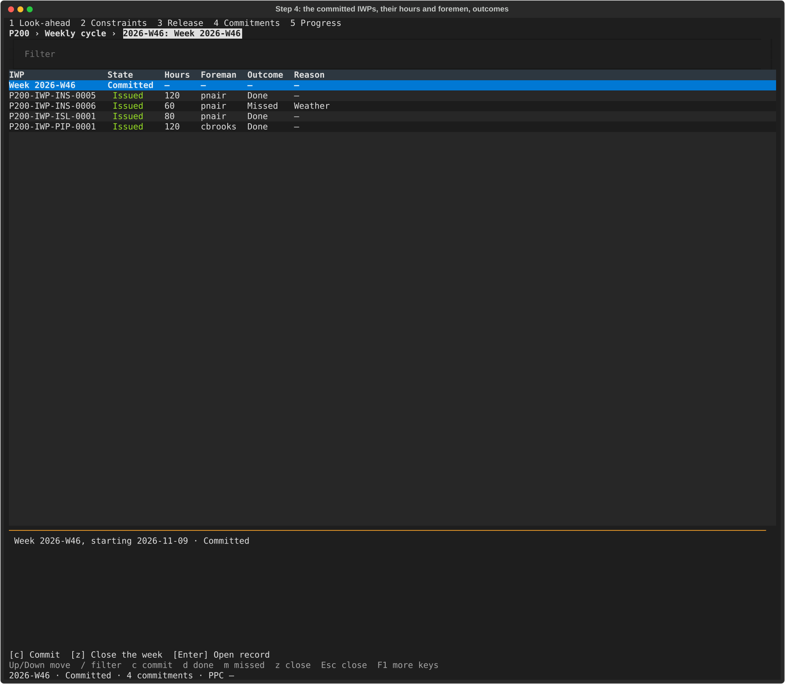
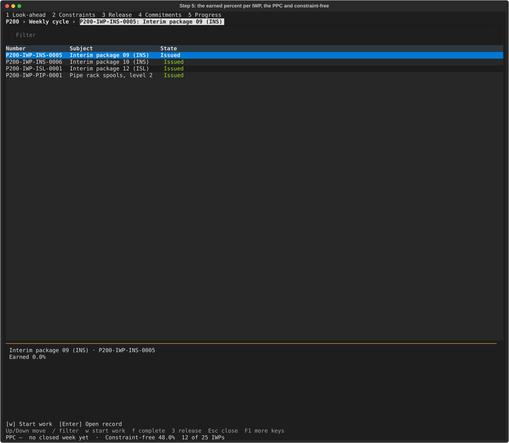
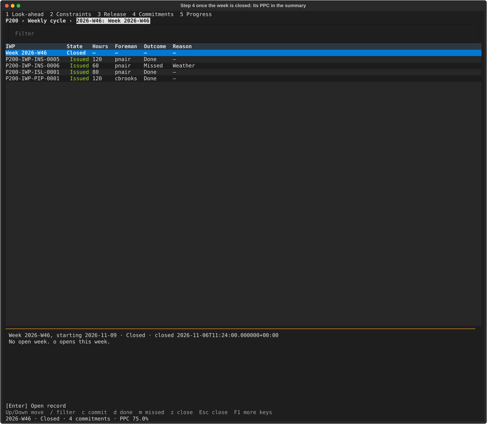
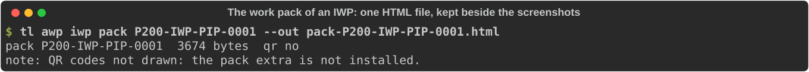

# Highlights: the everyday screens

Eighteen screenshots and one work pack: the eight everyday screens (the RFI log, an RFI, the correspondence log, a letter and the document log), the RFI's Activity and Insights and an intent in its history, a foreman's landing, and the weekly cycle of an awp project (the look-ahead, the constraints, the commitments, the progress and the closed week), with the work pack of one IWP. They are generated: `just tour highlights` (`uv run python dev/tour/highlights.py`) builds a small made-up project (four RFIs in different states, a few letters, three documents, the company standards loaded) and the awp project P200 of the demo generator (a published schedule, Issued packages, one week taken through its cycle), drives the real terminal UI headless and writes the SVG files and the pack HTML under `tour/highlights/`. The clock is frozen, so a second run changes no file. The full tours are [PHASE-0-TOUR](PHASE-0-TOUR.md) and [PHASE-1-TOUR](PHASE-1-TOUR.md); the layout rules these screens follow are in the `tui-layout` skill.

Each screen reads the same way: where you are, which record, what state, then the detail in named sections. The identity line (`number · subject`) and the state come first, then a summary line of the three or four facts a person decides by; every other value is a `Label  value` line, and anything that repeats (a list of revisions, response clocks, files, links, the timeline) is a small table with a dim header row. Only fields that can apply to this kind of record are shown (a letter we sent has no "Received" date), an applicable but empty value reads `—`, and codes read as words (`A, Issued for review`). The state is coloured (green done, amber waiting or running, red overdue or refused) and always written out, so it reads in monochrome too. The ids and keys the system uses inside are shown only to an admin who switches technical details on (Ctrl+D). Round 2 of the layout work (P1-UX3) added the summary line, the tables, the colour and the one-line keys row; the rules are in the `tui-layout` skill.

## 01 RFI log, wide

The list shows the number, the subject and the state first, then the fields people scan by (discipline, date needed). A column that is the same in every row, such as the kind (always "Request for information"), is left out until two kinds appear. The selected RFI sits to the right: under its state, a summary line (discipline, date needed, who it is with, days open), then its question, the key facts, the response clocks as a small table (the two rounds of one clock are told apart: "Answer required, round 2") and the start of the timeline. The keys row is one line: movement, the log's own filters, Esc and F1; every other key is on the help screen.

## 02 RFI log, stacked

On a narrower terminal the same record panel moves below the list. Only the subject is shortened (with `…`) to fit; the rest of the record is a key away (Enter). The keys row still fits one line.

## 03 An RFI's Details

Enter opens the record. The Details tab reads top to bottom: the question in full, the proposed solution, the key facts, the response clocks and the status timeline (oldest first, with who and why) as small tables, the files (name, type, size), the links and when the record was made. Extended properties are on the Properties tab, not here.

## 04 The RFI's Files tab

Key `6` lists the attachments as a small table with their type, size and, for a PDF, the page count; Enter or `v` opens the selected file in the system viewer (the actions bar says so, so the panel no longer repeats it as a hint).

## 05 The correspondence log

The register lists every letter, email and register item with number, subject and state first, then in or out, a short category (RFI, Letter, Transmittal) and who it is with. It is shown at 170 columns: where the eight columns would not fit without scrolling sideways, the least needed (the due date, then the date) are left out and the name of the other party shortens before the subject does. The selected letter shows a summary line (outgoing, to whom, when a reply is due), its message, the key facts, who it is from and to, the dates that apply to a letter we sent, the reply clock, the timeline, the files and the links.

## 06 A letter's Details

The letter's record leads with the message, then the key facts (the medium only when it differs from the kind of letter), the people (the drafter for a letter we sent), the dates (an outgoing letter has no "Received" or "Triaged on"), the response clock, the timeline, the files and the links. The delivery state and other plumbing are technical details.

## 07 The document log

Documents list the number, title and state first, then the current revision in words ("A, Issued for review"), the type and the discipline. The panel shows a summary line, the key facts, the revisions as a table (revision, state, purpose, date, files; the current one marked), the files of the current revision and the links, with a stale link marked `!`.

## 08 The document preview line

Under Files the panel gives the file's kind, size and page count; in a terminal that can show images it draws page 1 instead (the tour's terminal cannot, like the tests). `v` opens the file.

## 09 Record activity

Key `4` on a record opens its Activity tab: the events of the RFI by person and day, newest first, with what each one did (created, transitioned, answered, reissued) and the link added to the isometric. Read the When and Who columns first to see who did what on which day; the cursor on an event shows its intent below the list (shot 11).

## 10 Record insights

Key `9` opens the Insights tab: the checks that apply to this record, each with its result and what to do about it. Here the answer clock is past its due date ("20 days late"), and that is the first line to read.

## 11 Intent panel

An event that was made with a stated intent shows it under the Activity list when the cursor is on it: the reason (`Why`) and where the event moves the record toward (`Toward`, with the state or the condition it aims at). The goal line (`Goal`) is not drawn in this screen: the record view clips the last line of the panel, and a taller terminal does not show it (tried at 96 and 130 rows). This is a known gap for the layout work; the reason and the target are the part to read here.

## 12 IWP landing

A foreman who signs in lands on the IWP log with "mine" on. Read the Ready column first (the readiness checks passed, out of all of them), then Blocking (the open blocking constraints) and Since.

## 13 Week look-ahead

The weekly cycle opens from the palette ("Weekly cycle") on step 1: the look-ahead of the next weeks, the activities of the published schedule with their IWPs, the need-by date of each IWP and how many of its checks pass. Keys `1` to `5` move between the steps, as the steps line shows.

## 14 Week constraints

Step 2 lists the blocking constraints that are open or assigned, and the ones a check raised that were cleared as waived. The waived row shows `waived` in its state, and its panel gives who waived it and why (`waived by <who>: <reason>`, the words of `tl awp iwp show`). Read the state first, then the reason.

## 15 Week commitments

Step 4 shows the week's commitments: each IWP with its committed hours and foreman, then its outcome once it is recorded (done, or missed with its reason, here "Weather"). The week's row at the top gives its state; the summary line gives its PPC once it is closed (section 17).

## 16 Week progress

Step 5 lists the IWPs in the field (Issued, In progress, Field complete), and the KPI line: PPC (the share of the committed IWPs done) and constraint-free (the share of live IWPs with no open constraint). The panel of the highlighted IWP gives its earned percent, then one line per scope item with its steps. The highlighted IWP is the week's new package, `P200-IWP-PIP-0001`: its work is started and its first scope item has the material step done and is installed (by `tl awp iwp start-work`, `step` and `item-move`, the field verbs of clause 5 of the P2-I5 demo), so it reads `Earned 22.5%` (one of four items at 90%). The KPI line reads `PPC — no closed week yet` at this point: the week closes after this screen, so PPC appears in section 17; constraint-free reads 48.0%, 12 of 25 IWPs.

## 17 Week closed

Once the week is closed (by the controller, on its Friday, so the time in the panel is inside the week), step 4 reads Closed, its panel gives the close time in the plain form (`closed 2026-11-13 16:15`), and the summary line gives the week's PPC; the commitments keep their outcomes, and the new package reads In progress, its work having started before the close.

## 18 IWP pack

The work pack is not a terminal screen: `tl awp iwp pack <number> --out <file>` writes one self-contained HTML file for an IWP (its cover, scope and steps, drawings, take-off, safety, inspection and test plan, and sign-off), and the shot shows the command and its two lines of output. The file itself is kept beside the screenshots: [pack-P200-IWP-PIP-0001.html](tour/highlights/pack-P200-IWP-PIP-0001.html).
