# Phase 0 tour: what the platform core does, shown on screen

Purpose: show a reader who has not run the code what Phase 0 of Throughline delivered, one capability at a time, with real screenshots and a plain-language account of how the same activity is done today. Every screenshot is generated, not drawn: `uv run python dev/tour/phase0.py` builds a demo ledger, drives the real terminal UI headless and runs the real commands, and writes the SVG files under `tour/phase-0/`. Written 2026-10-13. Companion documents: [PHASE-0.md](PHASE-0.md) (the report), [PHASE-0-AUDIT.md](PHASE-0-AUDIT.md) (each brief §16 bullet against the code), and the interim [PHASE-1-TOUR.md](PHASE-1-TOUR.md) for what came after.

## What Throughline is, and what Phase 0 delivered

Throughline is a project-execution system of record for a general contractor: documents, engineering data, quality, piping, testing and the links between them, in one place instead of a document system, a completions database, email and many spreadsheets (brief §0, §1). Its backbone is an append-only ledger of attributable events; the current state of every record is a projection of that ledger, and every screen, API route, webhook and agent tool is generated from one semantic model. Phase 0 built that core and nothing on top of it that is domain-specific: a generic record with layered property sets, typed links, numbering and a workflow engine; a terminal UI, a REST API with live updates, MCP tools for AI agents, signed webhooks, a project feed, a signed archive with restore, an analytics copy, and layered settings. It runs on SQLite (and, in the parity suite, on PostgreSQL), and it is not deployable: real authentication was a Phase 1 item and is shown in [the Phase 1 tour](PHASE-1-TOUR.md).

The demo project is made up: project `P123`, a handful of valves and two quality records, three people (`amy`, `raj`, `demo`) and one AI agent (`triage`). All times are a frozen clock (2026-10-12), so the screenshots are identical on every run. Anything shown as "stored" was not re-run by the tour and says so.

| # | Capability | Screenshots |
|---|---|---|
| 1 | [Records and gap-free numbering](#1-records-and-gap-free-numbering) | `01a`, `01b` |
| 2 | [Layered property sets and conformance](#2-layered-property-sets-and-conformance) | `02a` to `02c` |
| 3 | [Links as first-class records, with expected links](#3-links-as-first-class-records-with-expected-links) | `03a` to `03d` |
| 4 | [A workflow whose guards read the data](#4-a-workflow-whose-guards-read-the-data) | `04a` to `04c` |
| 5 | [One query language for the TUI, the API and MCP](#5-one-query-language-for-the-tui-the-api-and-mcp) | `05a` to `05c` |
| 6 | [The project feed and live updates](#6-the-project-feed-and-live-updates) | `06a` to `06c` |
| 7 | [AI agents that propose and people who decide](#7-ai-agents-that-propose-and-people-who-decide) | `07` |
| 8 | [Signed webhooks to outside systems](#8-signed-webhooks-to-outside-systems) | `08` |
| 9 | [A signed, hash-chained archive and a restore from it](#9-a-signed-hash-chained-archive-and-a-restore-from-it) | `09` |
| 10 | [An analytics copy that answers as of a ledger position](#10-an-analytics-copy-that-answers-as-of-a-ledger-position) | `10` |
| 11 | [about:config: every setting visible, layered and lockable](#11-aboutconfig-every-setting-visible-layered-and-lockable) | `11a`, `11b` |
| 12 | [Company record types from a folder of files](#12-company-record-types-from-a-folder-of-files) | `12a`, `12b` |
| 13 | [One ledger on two databases](#13-one-ledger-on-two-databases) | `13` |

To open the TUI on a dev ledger yourself run `just tui` (it creates the dev account `demo` / `demo`); `just seed` fills a dev ledger with a simulated project. Keys named below are from the in-app help (`F1`).

## 1. Records and gap-free numbering

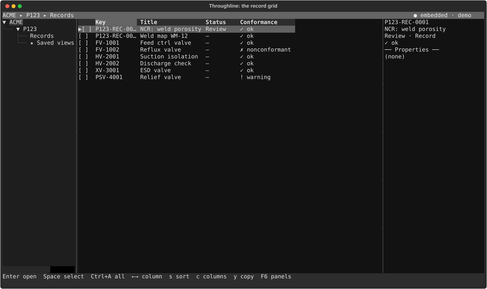

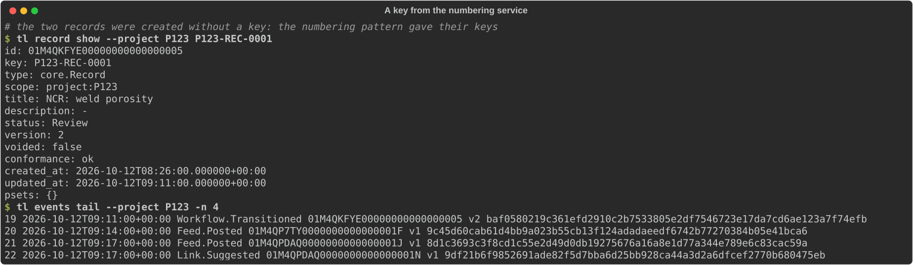

**Reproduce:** `just tui`, then `n` for a new record; or `uv run tl record create --project P123 --title "NCR: weld porosity"` (no key: the pattern gives one) and `uv run tl events tail --project P123`. The screens are `01a-record-grid.svg` and `01b-numbering-cli.svg`.

**Standard activity.** A project keeps a register of its items in a spreadsheet or in each tool separately. Whoever adds a row types the next number by hand, copies the last one, or asks a colleague. Numbers get reused, skipped, or typed differently in the drawing, the DMS and the completions list (brief §0.1 calls this identity drift), and a count of records means a count of rows.

**Novel approach.** Every record is a stream in the ledger with a common envelope (key, type, title, status, version, conformance). A numbering pattern (`{project}-{type}-{seq:4}`, `schema/fixtures/numbering/patterns.yaml`) allocates the key inside the transaction that creates the record: the ledger shows a `Numbering.Allocated` event immediately before `Record.Created`, so the sequence has no gaps and two writers cannot get the same number (P0-I3, [report](P0-I3.md)). The grid is a projection of those streams; the right-hand panel and the schema hash come from the same read.

**Unique value.** A key means one thing everywhere it is shown, and the event list is proof of how it was issued. Honest limits: a key longer than 12 characters is cut in the grid (`P123-REC-00…`, column widths are fixed in Phase 0), and `reserve_range` for pre-reserved number blocks is a stub (see the audit, row 3d).

## 2. Layered property sets and conformance

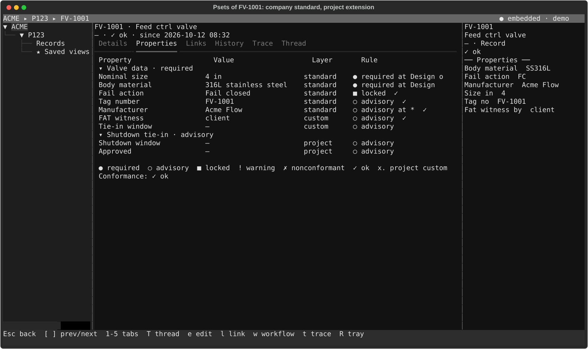

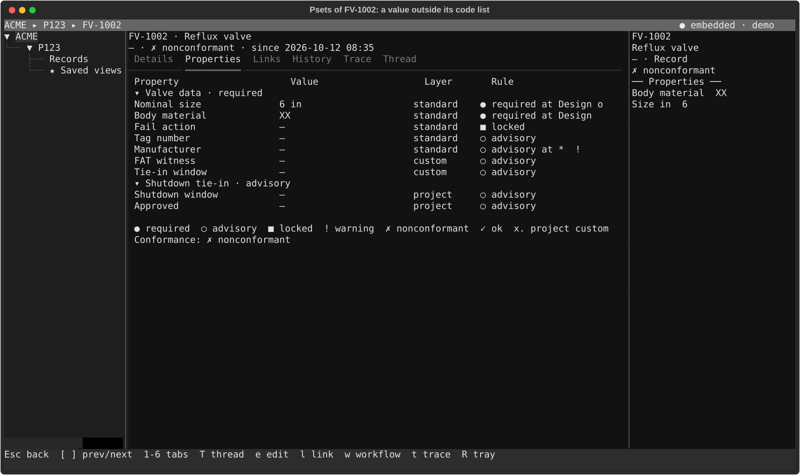

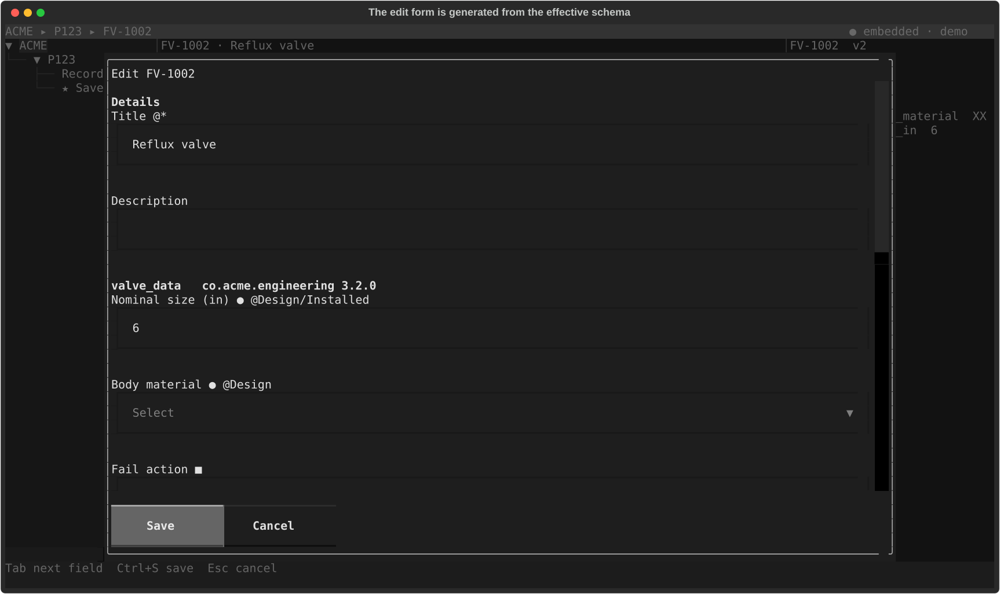

**Reproduce:** open a record and press `2` (Psets tab), `e` to edit; on the shell `uv run tl pset set --project P123 FV-1002 valve_data size_in=6 body_material=XX` and `uv run tl pset get --project P123 FV-1002`.

**Standard activity.** Engineering data lives in a datasheet per valve (a spreadsheet or a PDF) and in the tag list; the company's standard columns, the project's extra columns and one-off notes are mixed in the same sheet. Whether a value is allowed (a material code, a size range) is checked by eye at review, or by a macro nobody maintains, and a later change to the standard does not tell you which sheets it affects.

**Novel approach.** Properties live in typed, versioned property sets (psets) in layers: the company standard (`co.acme.engineering` 3.2.0), a project extension that may tighten it and add values (`x.P123`), a project's own pset (`prj.P123`) and a custom section (`x.` properties). The compiler turns the layers into one effective schema with a content hash; every `Pset.ValuesSet` event carries that hash, so a value is always tied to the exact rules it was written under (P0-I2, [report](P0-I2.md)). Every write is validated and its conformance evaluated; a value that breaks a rule (outside a code list, out of range, missing) is recorded with a verdict (`✗ nonconformant`, `! warning`) instead of being refused, so the data is never lost (a property set that is not in the effective schema is refused) and the problem is visible in the grid, the form, the workflow guards and the query language (`conformance:nonconformant`). The screens (psets tab, forms) are generated from the schema.

**Unique value.** The standard is enforced where the data is entered and the project can adapt it without code, yet one query still finds every record that breaks it. What it does not do yet: pset engagement is by value, not by class binding (class binding arrived for tags in Phase 1, P1-I1), and what a user may do with a `locked` pset is an open product question (PHASE-0.md H7).

## 3. Links as first-class records, with expected links

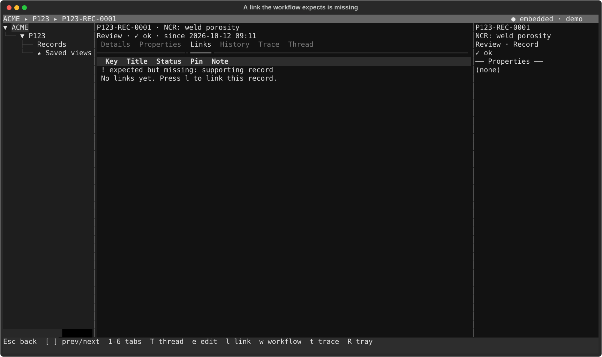

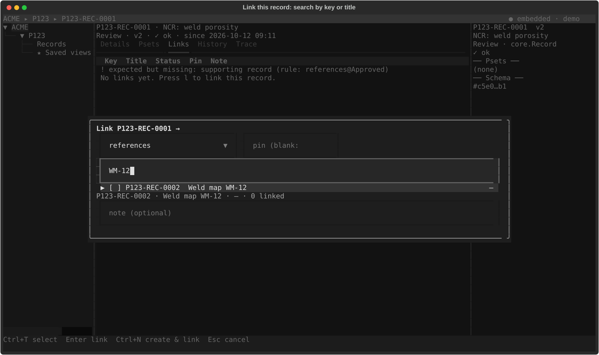

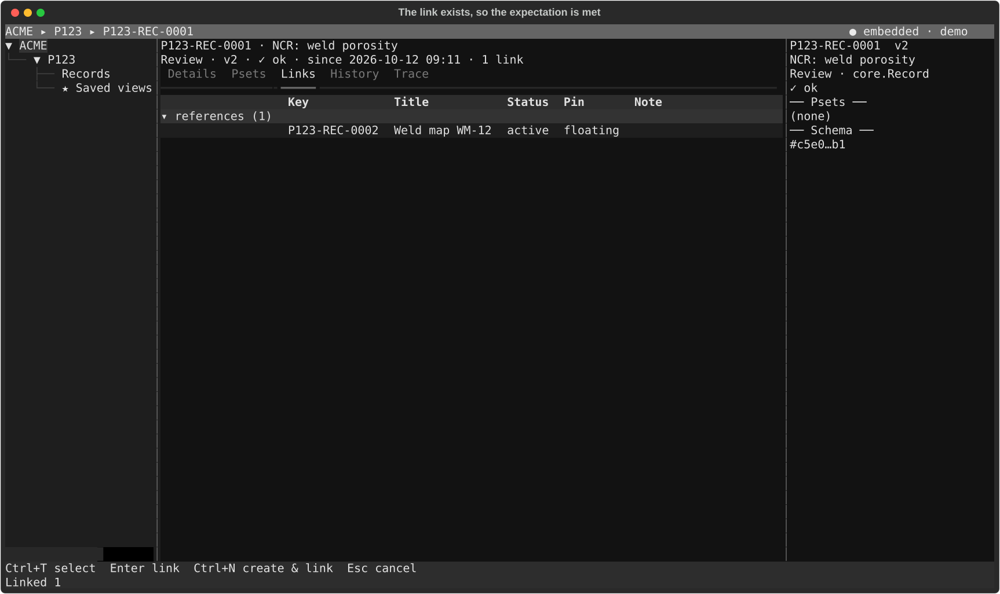

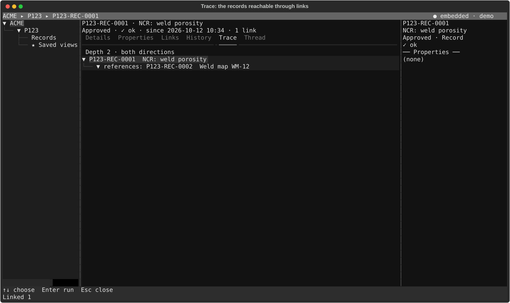

**Reproduce:** open `P123-REC-0001`, press `3` (Links tab), `l` to link, `5` for the Trace tab; on the shell `uv run tl link list --project P123 P123-REC-0001`, `tl link add`, `tl link trace`.

**Standard activity.** The link between an NCR and the weld map it concerns is a sentence in the NCR ("see WM-12 rev B") or a filename. Nobody can ask "which NCRs mention this weld map?" without searching text, and the link breaks silently when the map is revised (brief §0.1: references live in people's heads).

**Novel approach.** A link is its own stream with a lifecycle (suggested, active, stale, broken, retracted; never deleted), a typed relation with an inverse (`references` and `referenced by`), an optional pin to a revision and a note, and it is shown in both directions. Which links a record type is expected to have is part of the schema (`tl:expects_link`): here a record in state Approved is expected to reference a supporting record, and the Links tab says so while it is missing. The link picker, the reference tray, back and forward, and a depth-limited trace all read the same link projection (P0-I3, [report](P0-I3.md)).

**Unique value.** A reference can be followed, counted and queried (`linked:`, `count(linked:NCR)>0`, `missing(link:permit)`), and the absence of a required reference is a visible fact, not something a reviewer has to notice. Not built in Phase 0: a link-count column in the grid, link health checks on a schedule, and `path(...)` in the query language.

## 4. A workflow whose guards read the data

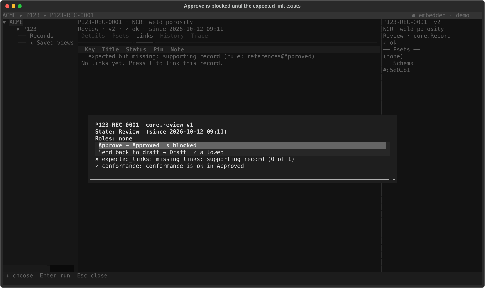

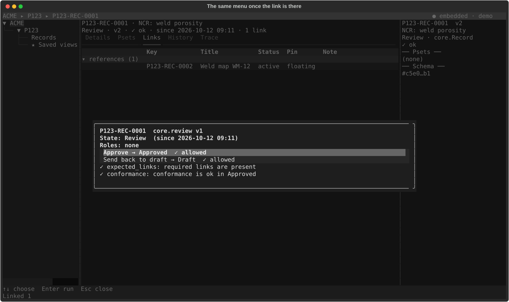

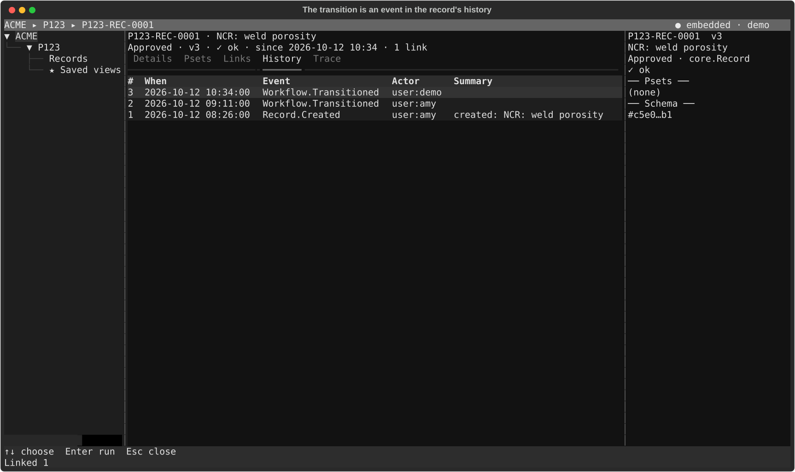

**Reproduce:** open a record and press `w`; on the shell `uv run tl wf show --project P123 P123-REC-0001` and `tl wf transition --project P123 P123-REC-0001 approve`.

**Standard activity.** An approval is an email, a signature on a PDF, or a status cell someone changes. The checks that should come first (is the supporting document attached? is the data complete?) are a checklist in someone's head, and the status can be changed without them.

**Novel approach.** A workflow is a declarative file (`schema/fixtures/workflows/core-review.yaml`): states, transitions and guards. A guard is evaluated against the current data: required property sets, conformance, required and expected links, and roles. The menu shows every transition with the result of each guard, and a refused transition lists exactly which guard failed (`✗ expected_links: missing links: supporting record (0 of 1)`). A transition that passes is a `Workflow.Transitioned` event, so the history, the feed card and any webhook get it for free (P0-I3).

**Unique value.** "Why can't I approve this?" has a one-line answer, and "who approved it, when, on what data" has a ledger answer. Honest limits: in Phase 0 the roles guard trusts a role list supplied by the caller (the real role model arrived with Phase 1 sign-in), and approvers, signatures, notifications and contractual clocks are not built.

## 5. One query language for the TUI, the API and MCP

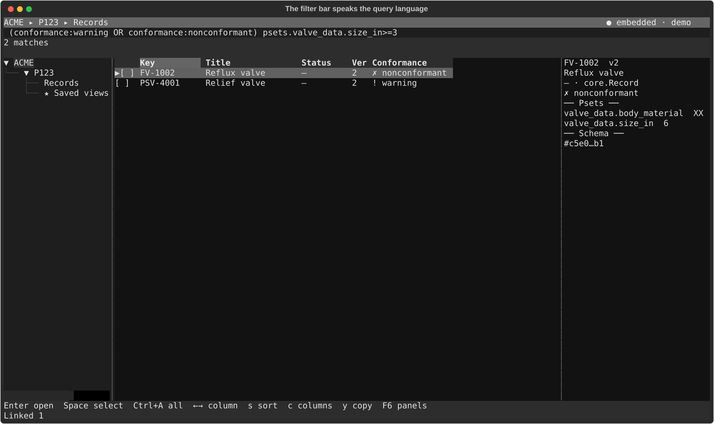

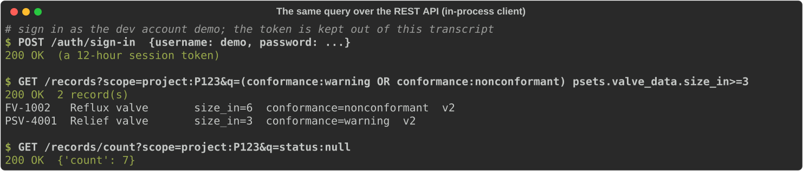

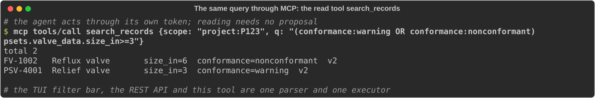

**Reproduce:** in the grid press `/` and type `(conformance:warning OR conformance:nonconformant) psets.valve_data.size_in>=3`; over HTTP `GET /records?scope=project:P123&q=...`; over MCP the tool `search_records`. The language is documented in `docs/reference/query-language.md`.

**Standard activity.** A report is a saved filter in one tool, a pivot table over an export in another, and a question to the person who knows the sheet. A person at the site, a script and an AI assistant each need a different way to ask the same question, and they get different answers because each applies the filter its own way.

**Novel approach.** There is one parser and one executor (`tl_core.query`). The TUI filter bar, the API's `q=` parameter and the MCP tool all send the same expression to it, with fields of the envelope, pset values (`psets.valve_data.size_in`), conformance, dates, boolean logic, text search and link terms. A syntax error comes back with the character position, which the filter bar shows under the text. The three screenshots show the same expression answering with the same two records, and the tour checks that the API and MCP results are identical (P0-I4, [report](P0-I4.md)).

**Unique value.** A question asked once can be reused by people, programs and agents, and the answer does not depend on which door they used. Known gaps: full-text search and the brief's example fields `discipline`, `area` and `due` are not in the envelope, and filters on link counts get slow at 100,000 records (PHASE-0.md §4, D1 to D3).

## 6. The project feed and live updates

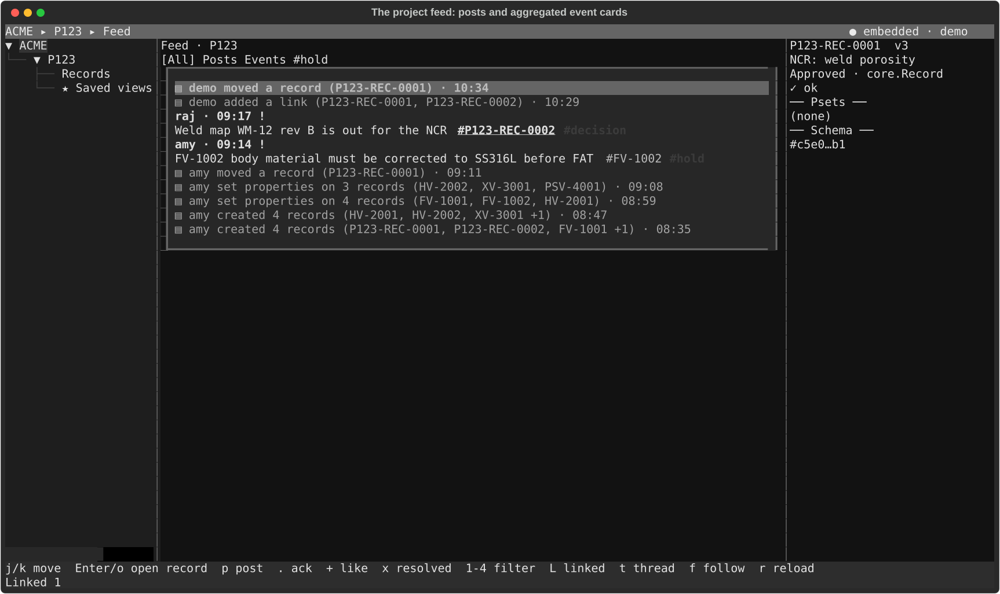

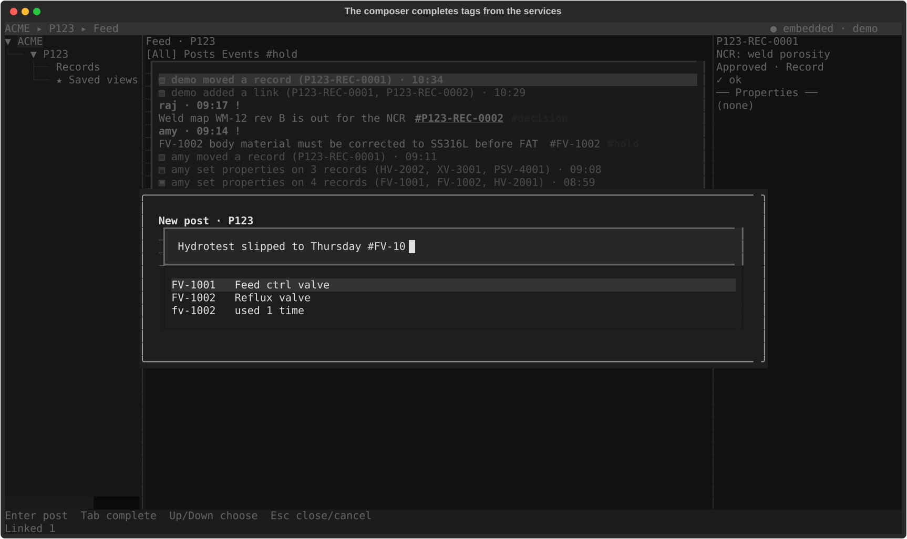

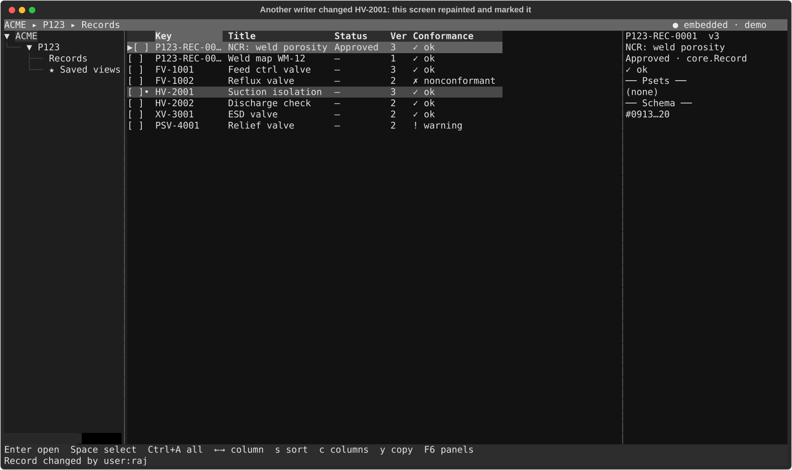

**Reproduce:** press `F` for the project feed (or on an open record, for that record's activity), `p` to post; on the shell `uv run tl feed post --project P123 "..." ` and `tl feed ls --project P123`. For live updates run two TUIs on one ledger (or `just serve` and `tl tui --remote ...`) and change a record in one.

**Standard activity.** Project news travels in email threads and chat channels, with a daily "what changed" meeting. The audit log, where there is one, is a separate screen nobody reads, and a colleague's change appears only when you reload the page.

**Novel approach.** The feed is a projection of the ledger. A post is an event with `#tags`: tagging a record key links the post to it (and suggests a `references` link), and a few signal tags (`#hold`, `#decision`) raise its importance. Ledger activity is aggregated into event cards, one run per actor and kind of change ("amy set properties on 4 records"), rebuilt deterministically from the events (P0-I6, [report](P0-I6.md)). The same change feed drives live updates: a TUI subscribes (in process, or over server-sent events from the API) and repaints the rows that changed, marking a record changed by someone else; the exit demo measured about 0.1 s between a write and the other screen (P0-I4, P0-I8).

**Unique value.** What people say and what the system recorded sit in one stream tied to the records, and nobody works on a stale screen. Honest limits: a comment is a feed post that tags a record, not a threaded conversation (threads with dispatch are Phase 1 or later), there are no follow or mute lists yet, and the remote client still does its reads on the UI thread with a three-second timeout.

## 7. AI agents that propose and people who decide

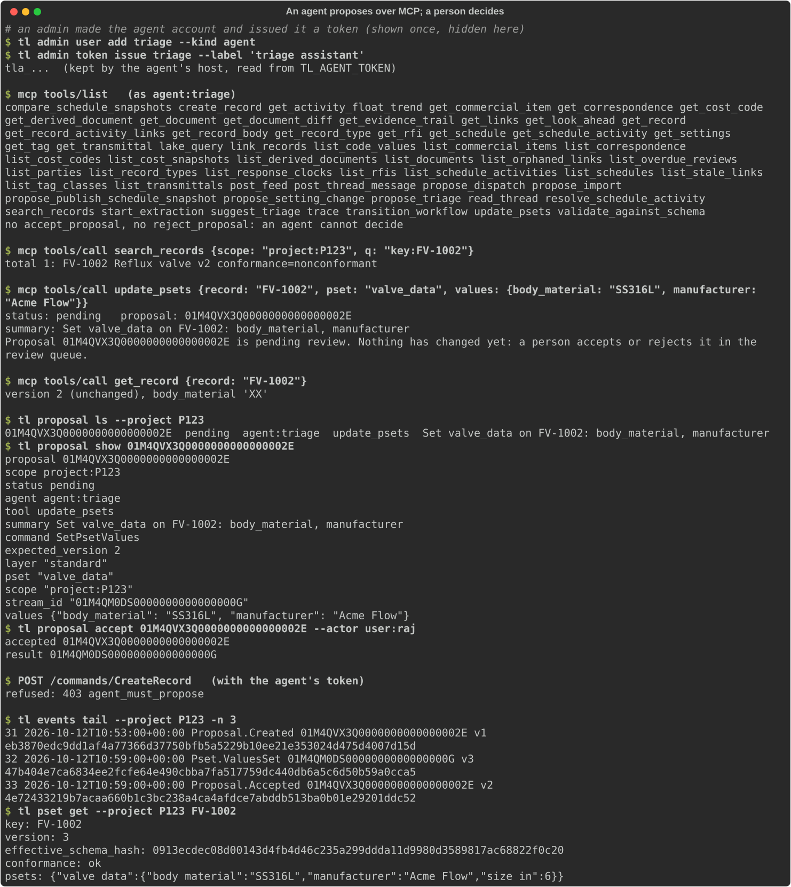

**Reproduce:** run the MCP server with an agent token (`TL_AGENT_TOKEN=... uv run python -m tl_mcp`) and call `update_psets`; review with `uv run tl proposal ls --project P123`, `tl proposal show <id>`, `tl proposal accept <id>`.

**Standard activity.** An AI assistant, where one is used at all, works outside the system: it reads exports, suggests edits in a chat, and a person re-types what they accept. Or it is given a service login that can change anything, and nobody can tell afterwards which edits were the assistant's.

**Novel approach.** The MCP server gives an agent the read tools and write tools that only propose. A proposal is a ledger event holding the exact command that would run (`SetPsetValues` on `FV-1002`, with the expected version), and nothing changes until a person accepts it; the accepted change is attributed to the person with the agent named as the source (`mcp:triage`). The agent has no accept or reject tool, an `agent:` identity is refused every record-changing REST command (`403 agent_must_propose`), and a daily proposal budget is a setting (`ai.agents.daily_proposals`). On this trunk the agent is identified by an admin-issued token (Phase 1, ADR-0009); in Phase 0 proper it was a static development token (ADR-0005, superseded) (P0-I6, [report](P0-I6.md)).

**Unique value.** An agent can be useful on real data without being trusted with it: every suggestion is reviewable, attributable and refusable, and the audit trail shows who decided. Honest limits: Phase 0 has no review-queue screen in the TUI (the queue is `tl proposal` and the API), the budget is the only rate control, and a "direct write" mode does not exist and would need a human decision (PHASE-0.md H4).

## 8. Signed webhooks to outside systems

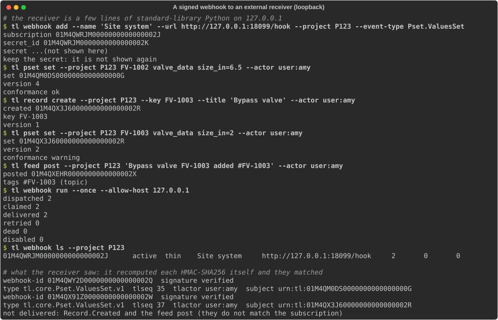

**Reproduce:** `uv run tl webhook add --name "Site system" --url https://... --project P123 --event-type Pset.ValuesSet`, then `tl webhook run` (the tour uses `--allow-host 127.0.0.1` for its loopback receiver); `tl webhook replay` re-sends a range; `tl webhook dlq ls` lists dead letters.

**Standard activity.** Another system gets Throughline-like data by a nightly CSV export, a point-to-point interface somebody wrote once, or a person who forwards an email. When the interface breaks nobody notices until the numbers disagree, and the payload has lost its units and meaning.

**Novel approach.** An outbound subscription filters events by type, record, field, transition, link relation, hashtag or query expression, and each delivery is a CloudEvents payload that names its ledger position (`tlseq`), actor and originating record. The delivery is queued in an outbox written in the same transaction as the event, so an event cannot be committed without being queued, and each is signed with the Standard Webhooks recipe (HMAC-SHA256 over `id.timestamp.body`). Per-subject ordering, retries with back-off, a dead-letter queue, replay by range, secret rotation and an egress policy that refuses private addresses are built in. The receiver in the tour is about thirty lines of standard-library Python that knows only the published recipe, and it verified both deliveries (P0-I5, [report](P0-I5.md)).

**Unique value.** An integration is contractual rather than hopeful: the receiver can prove who sent what, nothing is lost between commit and delivery, and a missed window is replayed rather than reconciled by hand. Honest limits: signing secrets are stored in plaintext in the database (a vault is a human gate, PHASE-0.md H3), the internet-facing egress path was never exercised, and delivery state is operational rows, not ledger events.

## 9. A signed, hash-chained archive and a restore from it

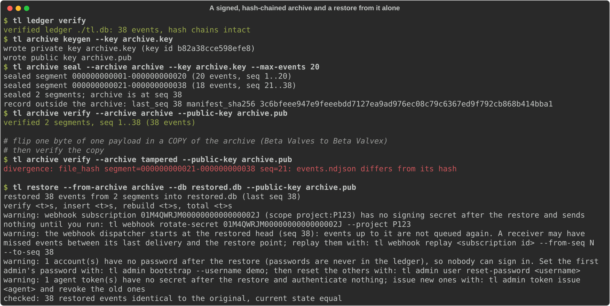

**Reproduce:** `uv run tl ledger verify`, `tl archive keygen`, `tl archive seal`, `tl archive verify`, `tl restore --from-archive <dir> --db restored.db`; `just demo P0-I7` runs the whole drill, and `just demo P0-I8` also restores into PostgreSQL.

**Standard activity.** A database is backed up nightly, and a backup is trusted until the day it is restored. Whether the history was altered between the event and the backup is not a question anyone can answer, and an auditor is shown an export.

**Novel approach.** Every event carries a hash of its content and of the previous event in its scope, so the ledger is a chain per scope that `tl ledger verify` recomputes. The archive seals consecutive events into segments (newline-delimited JSON and Parquet), each with a manifest signed with an Ed25519 key and pointing at the previous manifest's hash, so removing, reordering or editing anything is a divergence: the tour changes one byte of one payload in a copy and `tl archive verify` names the segment and the check that failed. `tl restore --from-archive` rebuilds a fresh database from the archive alone, rebuilds the projections, and verifies again; the tour compares every restored event and every current-state row to the original (P0-I7, [report](P0-I7.md)).

**Unique value.** "What did we know, and when?" has a checkable answer, and a restore is a tested procedure, not a hope. The restore output also says what a ledger cannot carry: passwords and secrets are never in it, so accounts, webhook secrets and agent tokens must be set again. Honest limits: the signing key is a file on disk (the tour derives one from a public phrase and says so), the archive is not on object lock, and restores of the live database (Litestream, pgBackRest) were drilled only on small data (PHASE-0.md H5).

## 10. An analytics copy that answers as of a ledger position

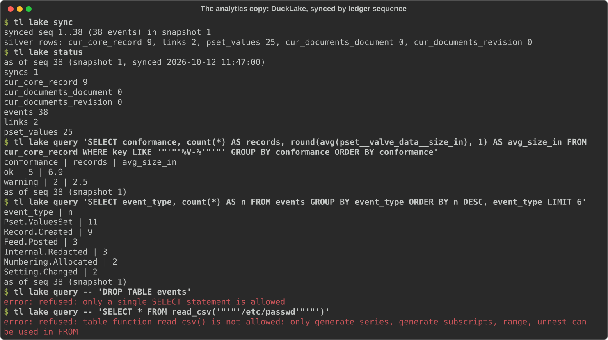

**Reproduce:** `uv run tl lake sync`, `tl lake status`, `tl lake tables`, `tl lake query "SELECT ..."`; the same read-only SQL is the MCP tool `lake_query`. `just demo P0-I7` runs it.

**Standard activity.** Reporting means an export of the operational database into a spreadsheet or a warehouse on a schedule, with a transform someone wrote, and a number in a report cannot be tied to a moment in the source.

**Novel approach.** A DuckLake copy holds the bronze events and the silver current state (records, links, pset values with promoted columns). `tl lake sync` copies the ledger events after the last synced sequence in one snapshot per sync, and every answer says which ledger position it reflects (`as of seq 38`). Queries go through a parser-based guard that allows one `SELECT` and refuses DDL, writes, `ATTACH` and file functions (the tour shows `DROP TABLE` and `read_csv('/etc/passwd')` refused), and rebuilding the lake from scratch gives the same state as syncing incrementally (P0-I7, [report](P0-I7.md)).

**Unique value.** Analysts and agents can ask free-form SQL questions without touching, or being able to damage, the system of record, and a result can be reproduced as of a position. Honest limits: the file catalog allows one writer (a PostgreSQL catalog is the production plan), bronze cannot yet be loaded from archive Parquet, and DuckLake is a young format that the build pins.

## 11. about:config: every setting visible, layered and lockable

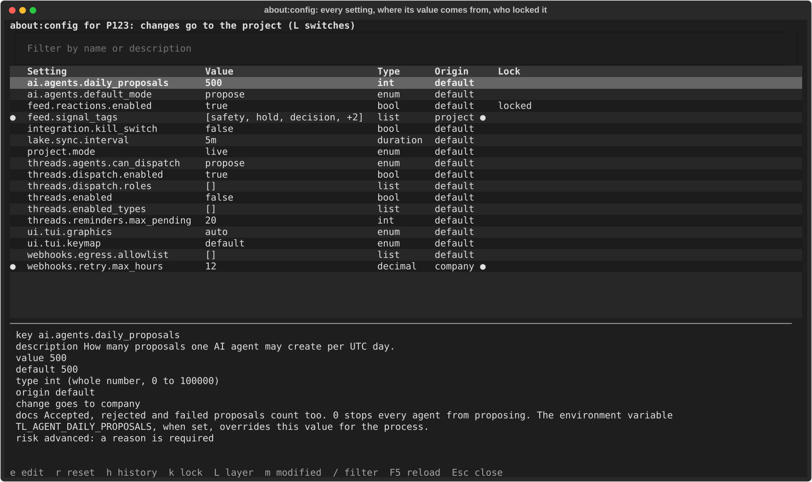

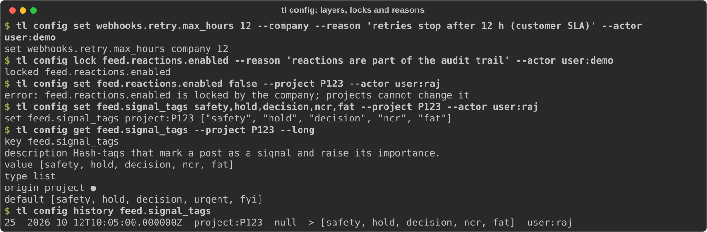

**Reproduce:** press `F9` (not `Ctrl+,`: terminals do not deliver it); on the shell `uv run tl config ls --project P123`, `tl config set`, `tl config lock`, `tl config history`.

**Standard activity.** Behaviour is configured in an admin screen per tool, or in a file on a server; who changed a rule, when and why is asked of the person who remembers, and a company cannot stop a project from changing a policy except by asking nicely.

**Novel approach.** A setting is a typed, documented key with a default, a risk class (`advanced` and `dangerous` keys need a reason) and the layers where it may be set (platform, company, project, user). Every change is a ledger event with actor, reason and time, history can be read and reverted, a company can lock a key or bound its values for projects, and a change can be scheduled. The TUI screen and the CLI show the effective value with its origin and any lock. Ten platform keys exist in Phase 0 (P0-I8, [report](P0-I8-A.md)).

**Unique value.** "Who changed this rule, and why" is a query, and company policy is enforced by the system rather than by memo. Honest limits: the TUI screen leaves out scheduled changes, company bounds and a diff against another project (use `tl config`), no key yet has a non-live effect that has been tested end to end, and who may change or lock a key is not restricted by role in Phase 0 (a human gate, PHASE-0.md H4).

## 12. Company record types from a folder of files

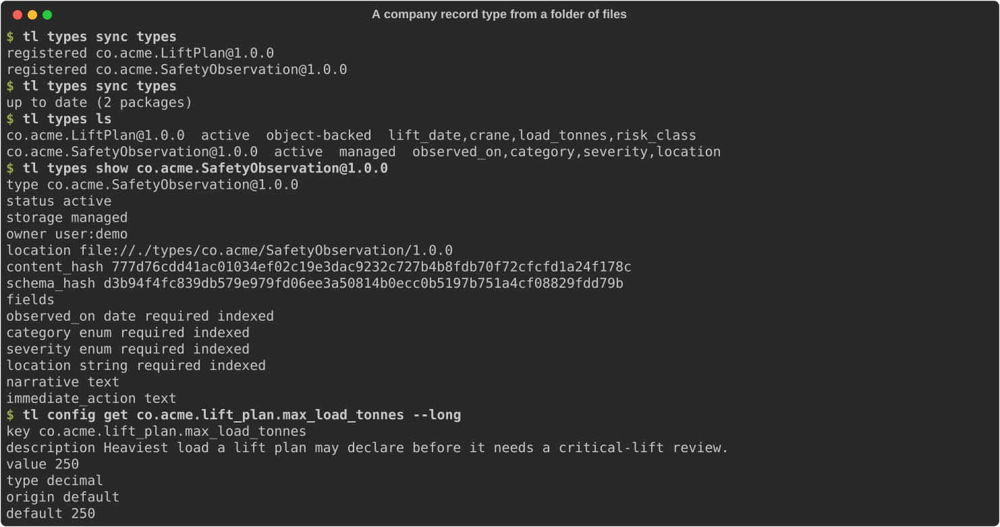

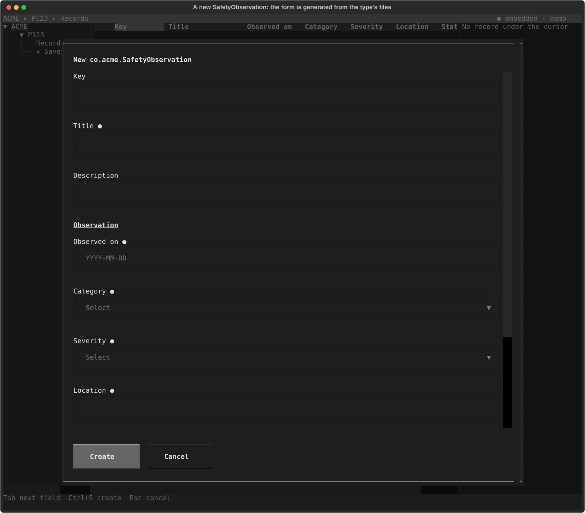

**Reproduce:** `uv run tl types sync <folder>` (the tour copies `schema/fixtures/types`), `tl types ls`, `tl types show co.acme.SafetyObservation@1.0.0`; in the TUI start with `--type co.acme.SafetyObservation` and press `n`.

**Standard activity.** A new kind of record (a lift plan, a safety observation) means a new spreadsheet or a request to the vendor, and a wait for the next release. The sheet's columns drift between projects.

**Novel approach.** A record type is a package: a few files in a folder (or object store) describing its fields, optional workflow and settings. `tl types sync` validates each package and registers it with one event, or quarantines it with the reason; running it again is a no-op. A type is either managed (values are psets in the ledger) or object-backed (a hash-verified body in the object store, with indexed fields), and either way the type appears in the generic API, MCP tools, grid columns and generated form without a release; its settings keys are namespaced to the type (`co.acme.lift_plan.max_load_tonnes`) (P0-I8, [report](P0-I8-B.md)).

**Unique value.** The company, not the vendor, adds record types, and they get search, links, history, webhooks and agents on day one. Honest limits: directory-backed storage and the external write path are refused, `type.lock` is not signed, discovery is a polling watcher, and there is no permission model yet for who may register or retire a type (PHASE-0.md H4, H9).

## 13. One ledger on two databases

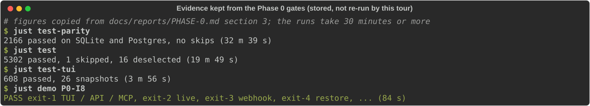

**Reproduce:** `just test-parity` (about 30 minutes, needs PostgreSQL); `just demo P0-I8` runs the exit clauses. The figures in the screenshot are copied from [PHASE-0.md](PHASE-0.md) §3 and were not produced by the tour.

**Standard activity.** A product that "supports two databases" is tested on one, and the other is found out in production: SQL that works on a laptop and not on the server, or the reverse.

**Novel approach.** The core is dialect-neutral: SQLite- and PostgreSQL-specific SQL lives only in the adapters, and DDL for both dialects is generated from the schema. A parity suite runs every test that touches a database on both adapters and fails, rather than skips, when PostgreSQL is unreachable. The exit demo restores one archive into SQLite and into a scratch PostgreSQL database and compares the results table by table (P0-I5, [report](P0-I5.md), [P0-I8](P0-I8.md)).

**Unique value.** A laptop and an edge server can run what the data centre runs, and a move between them is a restore, not a rewrite. Honest limits: the API server, the TUI and most commands opened SQLite files only in Phase 0 (Phase 1 changed that, see the next tour), writers queue on one advisory lock on PostgreSQL, and the CI workflow has never run on a hosted runner.

## What Phase 0 did not do

- **Nothing is deployable.** Authentication, roles and permissions, secrets handling and key custody are human gates (PHASE-0.md §6a, H3 to H5); Phase 1 added sign-in and two roles, not a permission model.
- **No domain modules.** Documents, engineering tags, quality, piping and the rest of the brief's modules are later increments; Phase 0's psets and links are generic.
- **No web or mobile client**, and no offline replica sync.
- **No upgrade tooling:** no shadow rebuild, compatibility matrix or `tl migrate` (a human gate).
- **No MinIO or object lock ever ran** (ADR-0002); the `fs` and moto-tested `s3` object stores stand in.
- **Performance misses at 100,000 records** are recorded (link-count and text filters, one pset sort); the rest of brief §15 is met (PHASE-0.md §4).
- **Comments are feed posts**, not threads; follow, mute and digest feeds do not exist.
- **The CI workflow was never run** on a hosted runner.

The full account, with every deviation, gate result and follow-up, is [PHASE-0.md](PHASE-0.md); the audit against the brief is [PHASE-0-AUDIT.md](PHASE-0-AUDIT.md).
