# Phase 1 tour: identity, standards, document control, derivation, schedules, correspondence, the integration layer, the schema registry and legacy loads

**Status: Phase 1 exit.** This tour covers what every Phase 1 increment added on top of the Phase 0 core (P1-I0, I1, I2, I2b, I3, I4, I5, I6, I7 and I8). Every increment is merged; the phase report is [PHASE-1](PHASE-1.md) and the report of the last increment is [P1-I8](P1-I8.md).

Purpose: show, with real screenshots and a plain account of today's practice, what Phase 1 delivered: real accounts and sessions, the company standards registry with engineering tags, document control and the controller role that lets a person who is not an admin do the controlling acts, the pipeline that turns a spreadsheet into validated records, Primavera schedules and cost periods, correspondence with response clocks and confidentiality, RFIs and commercial notices, the integration layer with record threads, and finally the schema registry and workbench, waivers and the conformance dashboard, legacy loads and the lake marts. Every screenshot is generated: `just tour 1` (`uv run python dev/tour/phase1.py`) builds a demo ledger, signs in as named people, drives the real terminal UI headless and runs the real commands, and writes the SVG files under `tour/phase-1/`. Written 2026-10-13, extended to P1-I7 and then to P1-I8 on 2026-10-20. Read [PHASE-0-TOUR.md](PHASE-0-TOUR.md) first for the core these build on.

## What these increments added

Phase 0 left the platform core without real authentication. **P1-I0** replaced the development identity stub with accounts, two roles to begin with (`admin` and `user`; P1-I2b added a third, section 14), signed-in sessions, agent tokens, an admin screen, and put the API, TUI, MCP server, simulator and every command group on either SQLite or PostgreSQL ([P1-I0 report](P1-I0.md), ADR-0009). **P1-I1** added the first domain module: a company standards registry (code lists, mnemonics, numbering patterns, tag classes) and engineering **tags** parsed and checked against it ([P1-I1 report](P1-I1.md), ADR-0010). **P1-I2** added **document control**: documents with registered numbers, revisions with a status class each, pinned links that go stale, transmittals, reviews and a legacy register import ([P1-I2 report](P1-I2.md), ADR-0011 and ADR-0012). **P1-I2b** added the third role, `document_controller`, which holds the controlling acts of document control without holding the keys to accounts or the engineering registry ([P1-I2b report](P1-I2b.md), ADR-0013). **P1-I3** added the derivation pipeline: a file attached to a document revision is read by an extractor, checked against a registered schema, compared with the pass before, and published as tags with provenance, or taken back ([P1-I3 report](P1-I3.md), ADR-0014). **P1-I4** added Primavera XER schedules as immutable snapshots with a comparison, stable activity links and a look-ahead, and cost periods with a budget report ([P1-I4 report](P1-I4.md), ADR-0015). **P1-I5** added correspondence: letters and emails in one master register, triage, response clocks, and confidentiality classes that every read path respects ([P1-I5 report](P1-I5.md), ADR-0016). **P1-I6** added RFIs and commercial notices on that module, with an escalation rule, time bars and an evidence trail ([P1-I6 report](P1-I6.md)). **P1-I7** added the integration layer (inbound endpoints, rules, enrichers, actions, one kill switch) and record threads with slash commands ([P1-I7 report A](P1-I7-A.md), [report B](P1-I7-B.md), ADR-0017 and ADR-0018). **P1-I8** added the schema registry and workbench (packages with a lifecycle, a classification and an impact report, project pins, waivers, a conformance dashboard, git export and import), legacy loaders with a plan, reconcile and compensate, and two lake marts ([P1-I8 report](P1-I8.md), runbooks `schema-package-change.md`, `legacy-load.md` and `lake-sync.md`).

The demo project is made up: project `P123`, five people (`demo`, an admin; `amy`, `ana` and `ben`, plain users, `ben` locked out for a while; and `dora`, who is granted the controller role in section 14, loses it at the end of that section and is given it back in section 16) and one agent `triage`. Each `tl` command in the transcripts is run as a named person with their own session, and the prompt shows who (`amy$`). The clock is frozen at 2026-10-12 and moves three minutes with every command, so dates are the same on every run. Sections 15 to 22 sign the people in again first, because a session lasts twelve hours of that clock.

**What is and is not enforced in Phase 1.** There are three roles: `user`, `document_controller` and `admin`. The controlling acts of document control (issuing, superseding or voiding a revision or a document, issuing a transmittal, applying a document import) need `document_controller` or `admin`. Loading the standards, applying a tag import, the registry commands and everything about accounts, roles and tokens need `admin`. Since P1-I5 (section 17, ADR-0016) confidentiality is enforced: a record has a class (`internal`, `restricted` or `privileged`), a plain user and an agent read `internal` only, a controller or an admin also reads `restricted`, and a hidden record answers as one that never existed. There are still no per-record access lists beyond naming people on a privileged item. Anything automated (a rule, an endpoint, an enricher, an action) acts as its own service actor with a declared access, and an agent only proposes (sections 18 and 19). Since P1-I8 (sections 20 to 22) a schema package version is approved by an admin who did not write or submit it, a waiver is approved by an admin who did not ask for it, and a legacy load, an export and an import are admin acts.

| # | Increment | Capability | Screenshots |
|---|---|---|---|
| 1 | P1-I0 | [Sign-in and sessions](#1-sign-in-and-sessions) | `01a` to `01c` |
| 2 | P1-I0 | [Accounts, roles and agent tokens](#2-accounts-roles-and-agent-tokens) | `02a` to `02c` |
| 3 | P1-I0 | [Account lockout](#3-account-lockout) | `03` |
| 4 | P1-I0 | [An agent with a service token](#4-an-agent-with-a-service-token) | `04` |
| 5 | P1-I0 | [The same services on PostgreSQL](#5-the-same-services-on-postgresql) | `05` |
| 6 | P1-I1 | [The company standards registry](#6-the-company-standards-registry) | `06` |
| 7 | P1-I1 | [Engineering tags checked against their class](#7-engineering-tags-checked-against-their-class) | `07` |
| 8 | P1-I1 | [The tag register and the legacy tag import](#8-the-tag-register-and-the-legacy-tag-import) | `08a` to `08c` |
| 9 | P1-I2 | [The document register: a status class per revision](#9-the-document-register-a-status-class-per-revision) | `09a`, `09b` |
| 10 | P1-I2 | [Stale pins and the re-pin diff](#10-stale-pins-and-the-re-pin-diff) | `10a` to `10c` |
| 11 | P1-I2 | [Transmittals and review rounds](#11-transmittals-and-review-rounds) | `11a` to `11c` |
| 12 | P1-I2 | [The legacy DMS register import](#12-the-legacy-dms-register-import) | `12` |
| 13 | P1-I2 | [What a plain user cannot do](#13-what-a-plain-user-cannot-do) | `13` |
| 14 | P1-I2b | [The document controller role](#14-the-document-controller-role) | `14a` to `14f` |
| 15 | P1-I3 | [The derivation pipeline](#15-the-derivation-pipeline) | `15a` to `15e` |
| 16 | P1-I4 | [Schedules and cost](#16-schedules-and-cost) | `16a` to `16e` |
| 17 | P1-I5 | [Correspondence, triage, clocks, threads and confidentiality](#17-correspondence-triage-clocks-threads-and-confidentiality) | `17a` to `17e` |
| 18 | P1-I6 | [RFIs and commercial notices](#18-rfis-and-commercial-notices) | `18a` to `18e` |
| 19 | P1-I7 | [The integration layer and record threads](#19-the-integration-layer-and-record-threads) | `19a` to `19e` |
| 20 | P1-I8 | [Schema registry and workbench](#20-schema-registry-and-workbench) | `20a` to `20f` |
| 21 | P1-I8 | [Waivers, conformance dashboard, crosswalk, export and import](#21-waivers-conformance-dashboard-crosswalk-export-and-import) | `21a` to `21c` |
| 22 | P1-I8 | [Legacy loads and lake marts](#22-legacy-loads-and-lake-marts) | `22a` to `22c` |
| 23 | P1-UX | [Plain language and the record screen](#23-plain-language-and-the-record-screen) | `23a` to `23g` |
| 24 | P1-UX2 | [The log standard, the RFI record and document preview](#24-the-log-standard-the-rfi-record-and-document-preview) | `24a` to `24g` |

## Regenerating locally

Run `uv sync --all-packages` once first. The tour needs no Postgres: it builds a fresh SQLite ledger in a temporary directory. Then:

- `just tour 1` rewrites `tour/phase-1/` (this tour); `just tour 0` rewrites `tour/phase-0/`; `just tour-all` does both.
- `just tour 1 some/dir` writes to another directory instead. The output is deterministic, so a rerun on unchanged code changes no SVG.

## 1. Sign-in and sessions

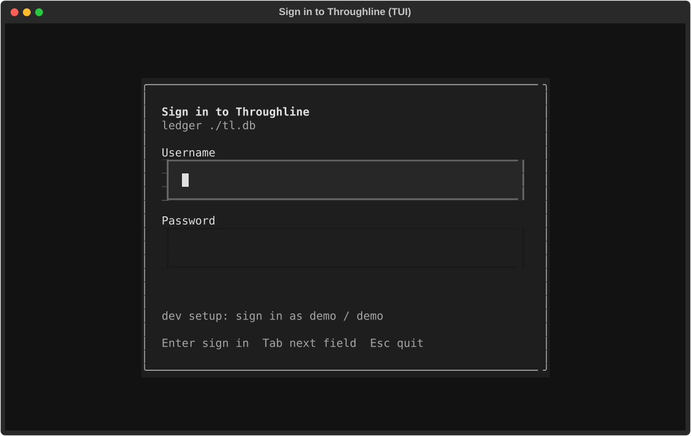

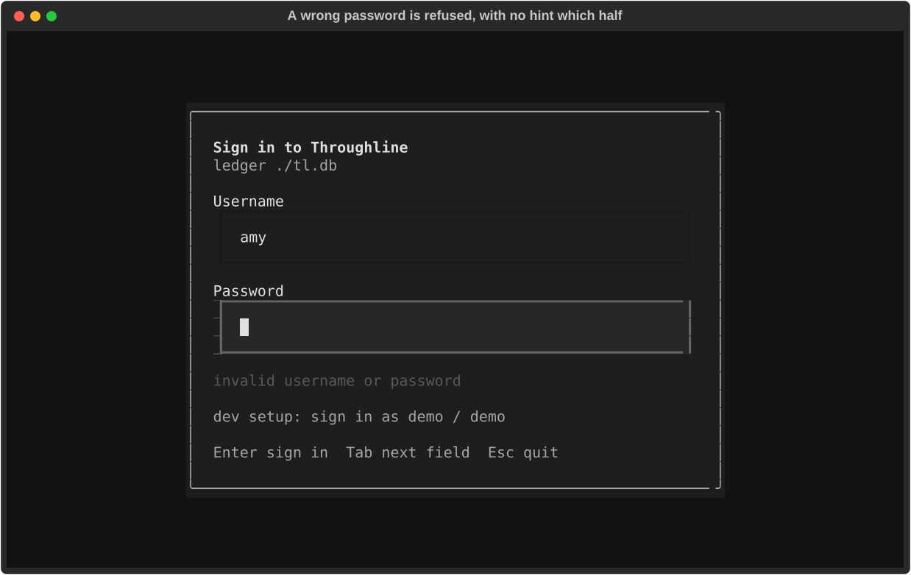

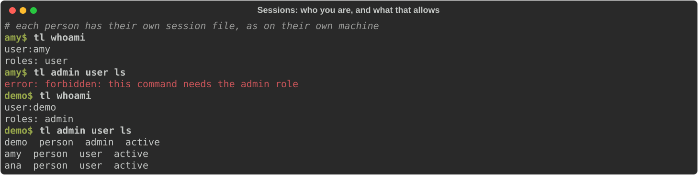

**Reproduce:** `just tui` (the sign-in screen), `uv run tl login amy`, `uv run tl whoami`. The dev account `demo` / `demo` exists only when `TL_ENV` is `dev`, `test` or `ci`.

**Standard activity.** Each tool has its own login, often a shared one for the site office, and external parties get a spreadsheet by email instead of an account. Who made a change is whatever the tool's audit log can say, if it keeps one.

**Novel approach.** One account store backs every door: the API, the TUI, the `tl` commands and the MCP server. A person signs in with a name and a password (kept as a salted scrypt hash, never in the ledger, a log or an event) and gets a session of twelve hours; the CLI keeps it in an owner-only file per ledger, the TUI holds it in memory. The sign-in screen refuses with one message whatever was wrong, and the actor on every event is the signed-in account. The identity layer is a seam (`IdentityProvider`) that an external provider such as Entra ID can replace (P1-I0, ADR-0009).

**Unique value.** "Who did this" is the answer to a sign-in, not a convention, on every entry point, and the same account works in the terminal, over HTTP and for scripts. Honest limits: this is password sign-in for a handful of accounts; single sign-on, MFA and permission rules finer than three company-wide roles are not built. The seeded `demo` account is a development convenience: the server refuses a non-loopback bind while it is enabled, and `tl init --dev` is refused with `TL_ENV=prod`.

## 2. Accounts, roles and agent tokens

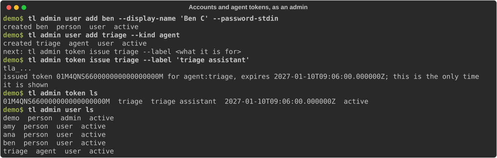

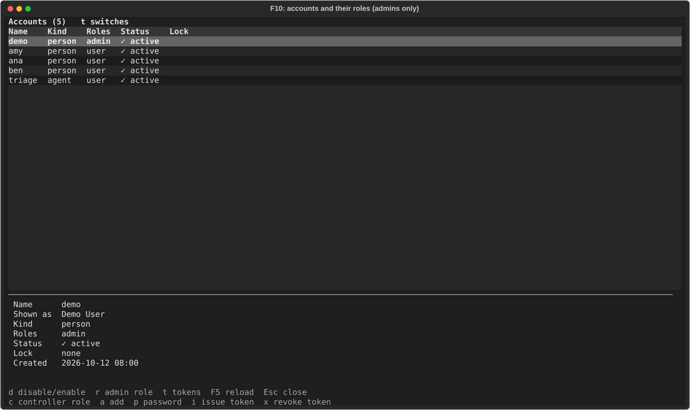

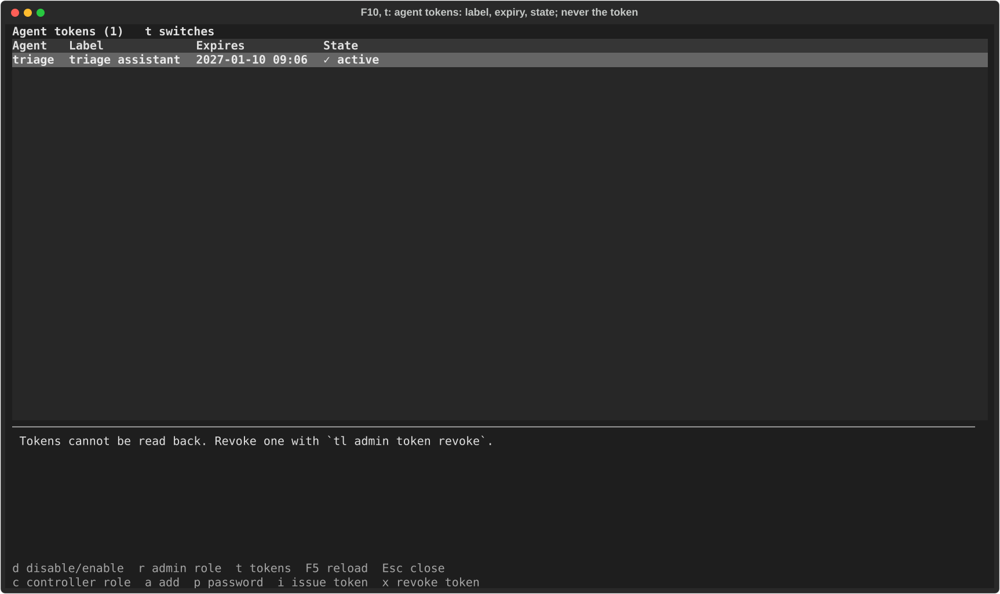

**Reproduce:** `uv run tl admin user add ben --display-name "Ben C" --password-stdin`, `tl admin user add triage --kind agent`, `tl admin token issue triage --label "triage assistant"`, `tl admin token ls`; in the TUI press `F10` as an admin. Runbook: `docs/runbooks/accounts-and-access.md`.

**Standard activity.** An administrator creates logins in each system, a shared service account is handed to whatever integration needs one, and nobody can say afterwards which of the account's actions came from a person and which from a script.

**Novel approach.** An account is a person, an agent or a simulator, with roles (`admin`, `user`), and sign-ins, failures and locks are written to an authentication audit log (`tl admin audit`). An agent has no password: an admin issues it a token that is shown once, stored only as a SHA-256 hash, has an expiry and a label, can be revoked at once, and is checked again on every call it makes. The accounts screen and the tokens view show who exists, in what state, and what tokens are live, and they are the same service calls the CLI and API use (P1-I0, ADR-0009).

**Unique value.** People and automation are separately named, separately revocable and separately accountable, and the last administrator cannot be removed by accident. Honest limits: three roles (section 14) and no groups, no per-project roles and no approval workflow for dangerous settings yet.

## 3. Account lockout

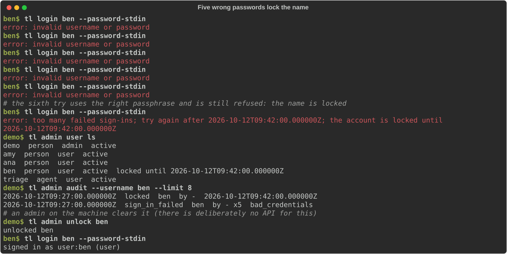

**Reproduce:** run `uv run tl login ben --password-stdin` five times with a wrong password, then once with the right one; `uv run tl admin user ls`, `tl admin audit --username ben`, `tl admin unlock ben`.

**Standard activity.** A password guesser is stopped, if at all, by whatever the tool vendor built; a locked-out user phones the administrator, who has no record of what was tried.

**Novel approach.** Failed sign-ins are counted per name: after five the name is locked for a time and even the correct passphrase is refused, so guessing gains nothing. A limiter per source address adds a second brake on the API. The failures and the lock are audited (`tl admin audit` shows `sign_in_failed x5` and `locked`), the accounts list shows the lock, and clearing it is deliberately a local administrator command with no API route (P1-I0, ADR-0009).

**Unique value.** An attacker cannot walk through a password list, and the attempt leaves a record an administrator can read. Honest limits: the lock is flat per name (not escalating), so someone who knows a name can lock that person out for a while; there is no alert yet when it happens.

## 4. An agent with a service token

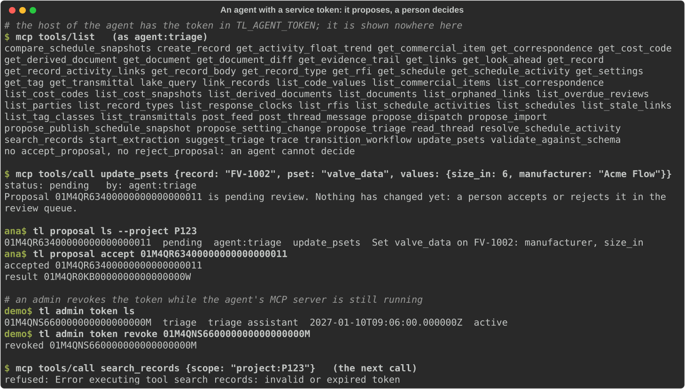

**Reproduce:** `TL_AGENT_TOKEN=... uv run python -m tl_mcp` with a token from `tl admin token issue`; call `update_psets`; review with `tl proposal ls` and `tl proposal accept <id>`; revoke with `tl admin token revoke <id>`.

**Standard activity.** An AI assistant is handed an API key that can do whatever the key's owner can, the key lives in a configuration file, and revoking it means finding every place it was pasted.

**Novel approach.** The agent is whoever its token says. It reads freely, but its write tools only propose: a proposal is a ledger event holding the exact command, and a person accepts it (here `ana`), so the change is attributed to the person and the agent is the source. The agent has no accept tool, and an explicit allow-list of MCP actions means a new tool is closed to agents until someone opens it. The token is checked on every call: the screenshot revokes it while the agent's server is still running, and the very next call is refused (`invalid or expired token`) (P1-I0, ADR-0009).

**Unique value.** An agent is useful, auditable and switchable off in one command, and nothing it suggests changes a record until a person decides. Honest limits: a per-agent budget and display name are not built (one daily proposal limit applies to every agent), and an agent's access is the fixed allow-list, not a per-agent grant.

## 5. The same services on PostgreSQL

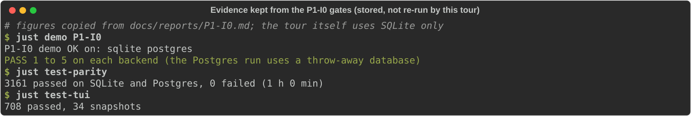

**Reproduce:** `just dev up`, then `just demo P1-I0` (about three minutes per backend) and `just test-parity` (about an hour). The figures in the screenshot are copied from the [P1-I0 report](P1-I0.md) and were not produced by the tour, which uses SQLite only.

**Standard activity.** A product is demonstrated on one database and installed on another; the first production data is the first test of the second.

**Novel approach.** In Phase 0 only the library and the restore reached PostgreSQL; the API server, the TUI, the MCP server, the simulator and every `tl` command group opened SQLite files. P1-I0 gave all of them one backend factory that takes a SQLite path or a `postgresql://` URL, a test pins that no entry point imports the SQLite adapter, and the demo runs the same clauses on both. On a PostgreSQL ledger the CLI always needs a signed-in session.

**Unique value.** The laptop demonstration and the server installation are the same code on different storage, with a parity suite that must pass on both. Honest limits: the tour itself did not run PostgreSQL, a long parity run is the release gate for adapters, and writers on PostgreSQL still queue on one advisory lock.

## 6. The company standards registry

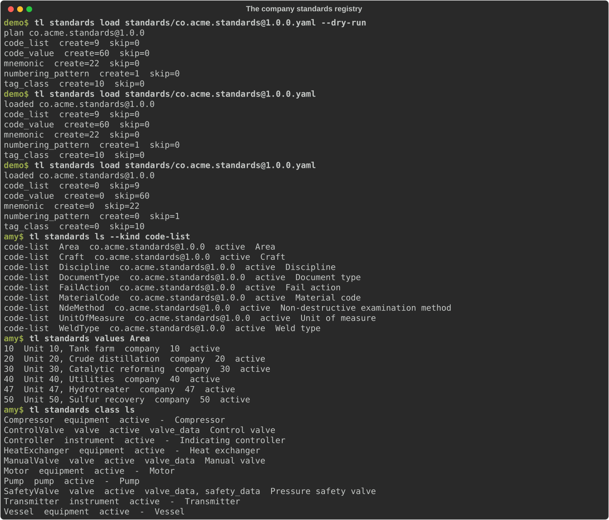

**Reproduce:** `uv run tl standards load schema/fixtures/standards/co.acme.standards@1.0.0.yaml --dry-run`, then without `--dry-run`, `tl standards ls --kind code-list`, `tl standards values Area`, `tl standards class ls`. Runbook: `docs/runbooks/engineering-standards-and-tags.md`.

**Standard activity.** The company's naming rules, area and discipline codes, material codes and valve classes live in a PDF procedure and in a spreadsheet each project copies and edits. Projects drift, and nobody can say which project is using which edition.

**Novel approach.** The standards are data in the system of record: code lists (with a policy on whether a project may extend them, and crosswalks between code systems), mnemonics, numbering patterns and tag classes, loaded from one YAML edition by an admin. The load shows its plan first (counts of what it would create or skip), is idempotent (a second load creates nothing), and registry entries are versioned and closed rather than overwritten. A tag class names the property sets a tag of that class must carry (`ControlValve` requires `valve_data`) (P1-I1, ADR-0010).

**Unique value.** One company standard is readable by everyone through the same tools and is the thing that numbers, forms and checks are generated from, so a project cannot silently fork it. Honest limits: the sample code lists use placeholder labels; there is no publish-and-review workflow for a new edition, only an admin load; and the registry is not yet used by modules beyond tags and documents.

## 7. Engineering tags checked against their class

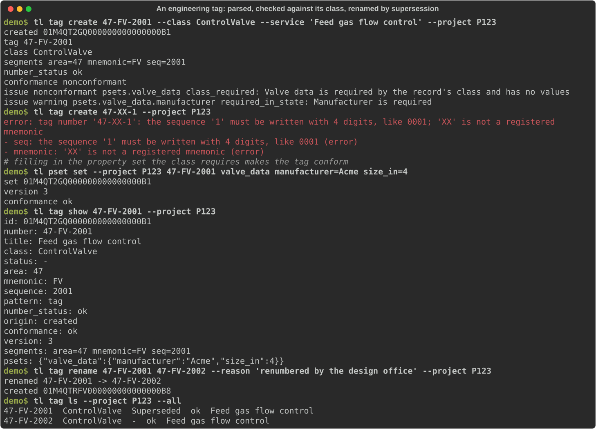

**Reproduce:** `uv run tl tag create 47-FV-2001 --class ControlValve --service "Feed gas flow control" --project P123`, `tl tag create 47-XX-1 --project P123`, `tl pset set --project P123 47-FV-2001 valve_data manufacturer=Acme size_in=4`, `tl tag rename 47-FV-2001 47-FV-2002 --reason "..." --project P123`, `tl tag ls --all`.

**Standard activity.** A tag list is a spreadsheet: a number typed by hand, a class chosen from memory, and the data sheet for the valve filled in later or never. The same tag is keyed `47-FV-2001` in one system and `FV2001` in another, and a renumbering is an edit that erases the old number from history.

**Novel approach.** A tag number is parsed into typed segments against the registry's pattern (`area=47 mnemonic=FV seq=2001`) and a wrong number is refused with every problem at once (`'XX' is not a registered mnemonic`, `the sequence '1' must be written with 4 digits`). The class makes property sets mandatory: a new `ControlValve` is recorded as `nonconformant` with `valve_data class_required` until the data is entered, and then conforms. A rename creates a new tag that supersedes the old one, which stays in the ledger and keeps its number for good (P1-I1, ADR-0010).

**Unique value.** A tag's identity is checked at the door, its data requirements follow from its class, and its history survives renumbering. Honest limits: the demo uses a small sample standard (22 mnemonics, ten classes); split and merge are supersession too but are not shown; and the workflow guard that holds a tag back while its data is missing is not shown here.

## 8. The tag register and the legacy tag import

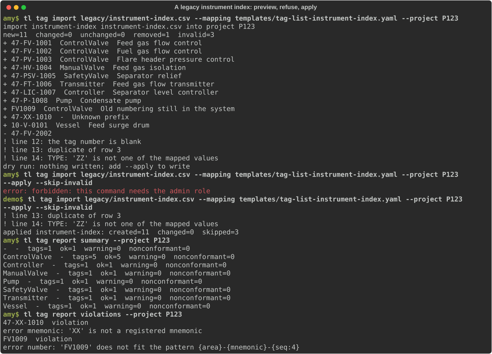

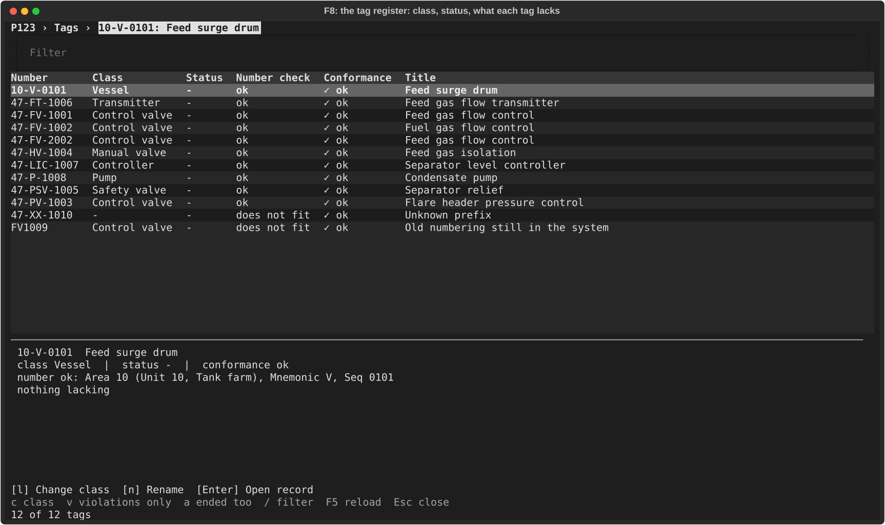

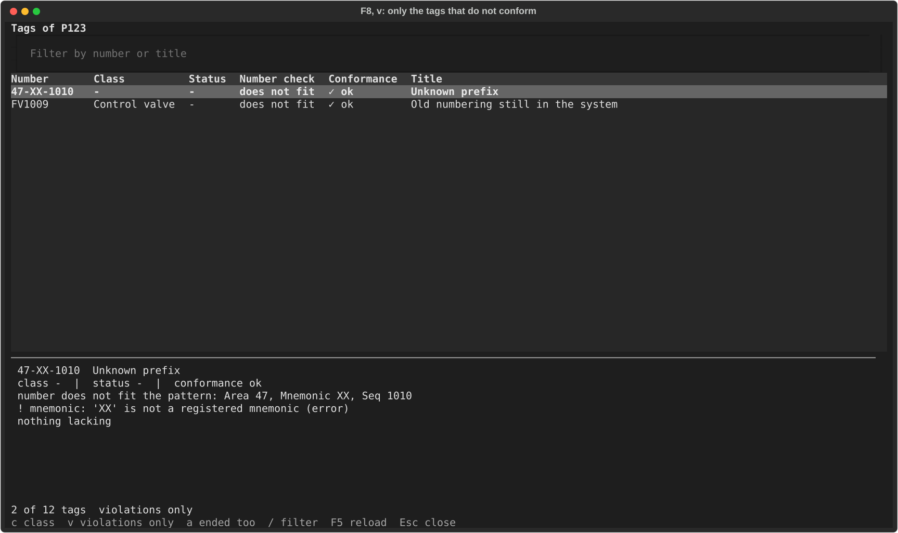

**Reproduce:** `uv run tl tag import dev/seed/legacy/instrument-index.csv --mapping dev/seed/templates/tag-list-instrument-index.yaml --project P123` (preview), add `--apply --skip-invalid` as an admin; `tl tag report summary|violations|missing --project P123`; in the TUI press `F8`, then `v`.

**Standard activity.** An instrument index arrives from the client or the old system as a spreadsheet. Someone fixes it by hand, pastes it into the new tool, and finds the bad numbers when a report fails, or never.

**Novel approach.** The import judges the file before it writes anything: the mapping maps columns to fields and the values to the standard's codes, and the preview lists every row that would be created, and every refused row with its line and reason (`line 13: duplicate of row 3`, `TYPE: 'ZZ' is not one of the mapped values`). Applying is an admin act. A legacy number that does not fit the pattern is kept, and marked as a violation, rather than silently fixed or dropped (`FV1009`, `47-XX-1010` in the violations report). The register shows each tag with its class, status and what it lacks, and `v` narrows it to the violations (P1-I1).

**Unique value.** A migration is done with the problems in view and nothing half imported, and the legacy numbers stay findable until the people who own them decide. Honest limits: the preview lists one tag the file does not mention (`- 47-FV-2002`, counted as `removed=1`) while the apply summary reports only created, changed and skipped, so read the runbook before relying on removals; and the import judges one list against the standard, it does not reconcile against other systems.

## 9. The document register: a status class per revision

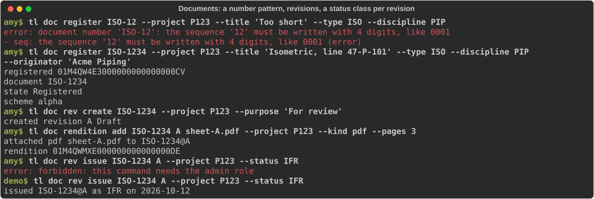

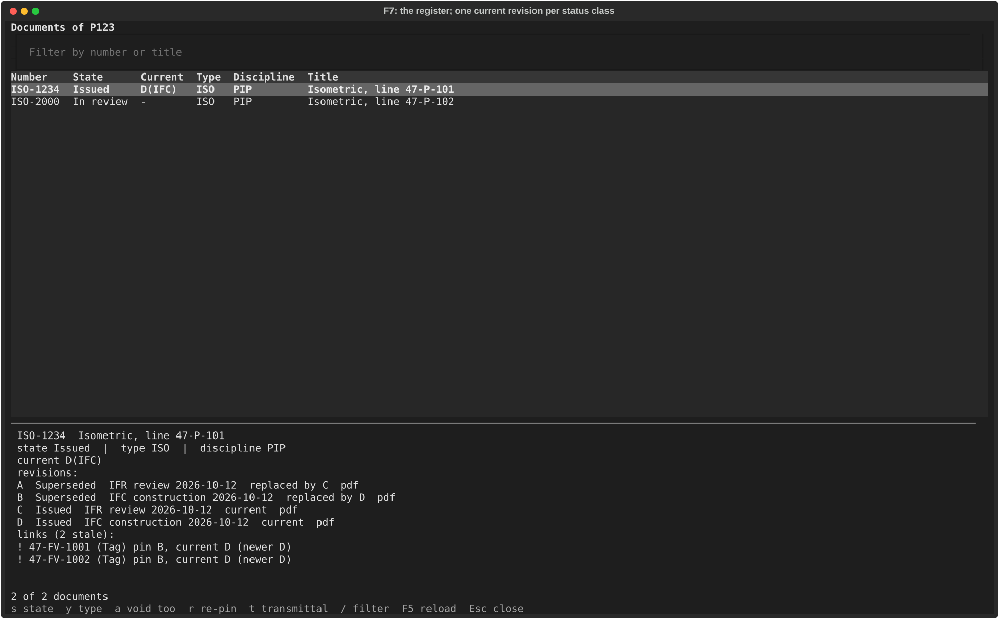

**Reproduce:** `uv run tl doc register ISO-1234 --project P123 --title "..." --type ISO --discipline PIP`, `tl doc rev create`, `tl doc rendition add`, `tl doc rev issue ISO-1234 A --status IFR` (a controlling act: admin, or a document controller, section 14), `tl doc show ISO-1234 --project P123`; in the TUI press `F7`. Runbook: `docs/runbooks/documents.md`.

**Standard activity.** A document register is a list in the DMS with one "latest revision" column. A revision issued for review and one issued for construction fight for that column, so the crew either builds from a drawing nobody has approved or from a superseded one.

**Novel approach.** A document number is checked against the company's pattern at registration (`ISO-12` is refused: four digits required). Revisions follow a configurable scheme (alpha here), carry a purpose, a status code with a class (`IFR` is `review`, `IFC` is `construction`) and renditions that are files in the file service. A document keeps one current revision per status class, so in the register `ISO-1234` shows `current D(IFC)` while revision C (`IFR`, for review) is also current in its own class and A and B are superseded. A user drafts; issuing is a controlling act, which was an admin's in P1-I2 (ADR-0011) and is a document controller's or an admin's since P1-I2b (ADR-0013, section 14).

**Unique value.** The builder sees the revision to build from while the reviewers see theirs, and nobody argues over which one is "current". Honest limits: at the time of P1-I2 `confidentiality` was a recorded field and nothing enforced it; derived documents and document schemas are later (P1-I3).

## 10. Stale pins and the re-pin diff

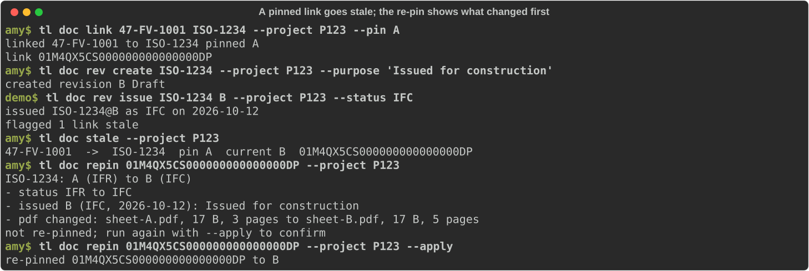

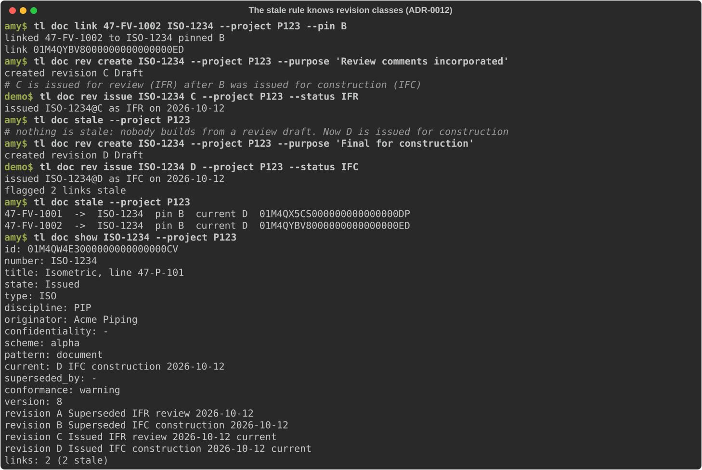

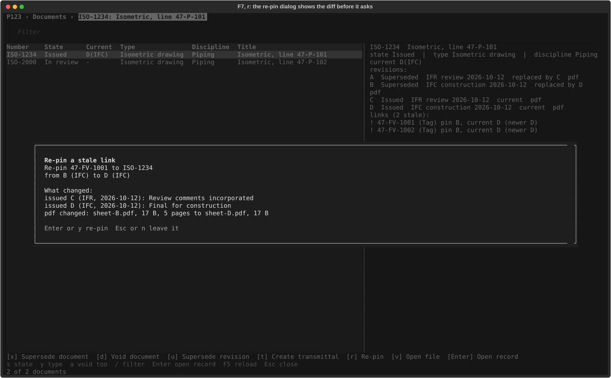

**Reproduce:** `uv run tl doc link 47-FV-1001 ISO-1234 --project P123 --pin A`, issue a later revision as an admin or a document controller, then `tl doc stale --project P123`, `tl doc repin <link> --project P123` (shows the diff) and `--apply`; in the TUI press `F7`, highlight the document and press `r`.

**Standard activity.** A tag's data sheet points at "ISO-1234 rev A". When rev B is issued nobody tells the person who depends on A; the crew builds from the old isometric because the issue was not connected to the work that uses it (brief §0.1).

**Novel approach.** A link can pin a revision or float. Issuing a revision flags every pin that is behind as stale, by a class-aware rule (ADR-0012): a pin on an `IFC` revision is stale when a newer `IFC` is issued, not when an `IFR` is, so review drafts nobody builds from raise no alarm. The screenshot shows `IFR` C leaving the pins on B alone and `IFC` D flagging both. Re-pinning shows the diff first (status, what was issued and why, whether the file changed and its page count) and moves the pin only on a yes, in the CLI with `--apply` and in the TUI dialog.

**Unique value.** An engineer re-pins knowing what changed, and a crew is told when the drawing behind its work has moved, without being warned about drafts. Honest limits: a "newer revision in review" marker beside a healthy construction pin was the owner's option C and is a filed follow-up; in the tour, links are flagged at the moment a revision is issued.

## 11. Transmittals and review rounds

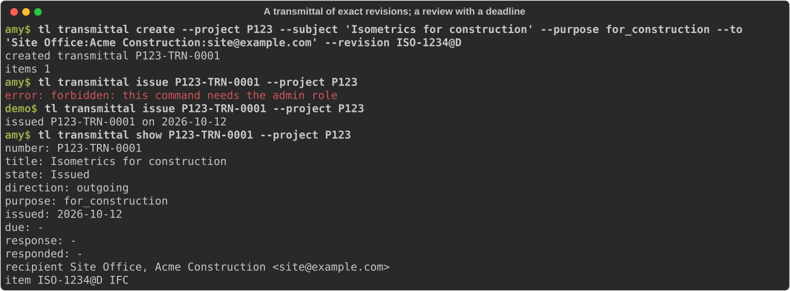

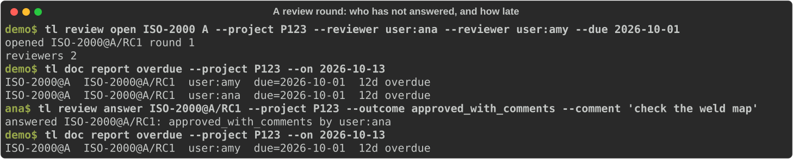

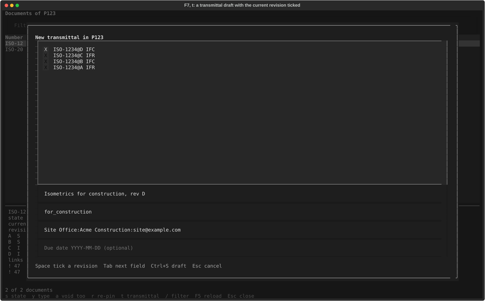

**Reproduce:** `uv run tl transmittal create --project P123 --subject "..." --purpose for_construction --to "Site Office:Acme Construction:site@example.com" --revision ISO-1234@D`, `tl transmittal issue P123-TRN-0001` (admin or document controller), `tl transmittal show`; `tl review open ISO-2000 A --reviewer user:ana --due 2026-10-01`, `tl review answer ISO-2000@A/RC1 --outcome approved_with_comments`, `tl doc report overdue --on 2026-10-13`.

**Standard activity.** A transmittal is a form or an email with attachments, and the record of what was sent to whom is the sent folder. A review is a round of emails; who has not answered is found by reading the thread, and the deadline is in someone's calendar.

**Novel approach.** A transmittal's items are exact issued revisions (`ISO-1234@D`, with its status), numbered by the allocator (`P123-TRN-0001`), drafted by anyone and issued by an admin or a document controller, and the response is recorded on the same record. A review round names its reviewers and a due date; each reviewer answers with an outcome and a comment, and the overdue report lists the reviewers who have not, with the days late (12 days at the report's date), and drops each one when they answer (P1-I2).

**Unique value.** "Which revision did we send them, and when" and "who still owes us an answer" are answered by a command, not by archaeology. Honest limits: recipients are names and email addresses recorded on the transmittal and the system sends no email (there is no mail sender in the code), and since confidentiality is not enforced a recipient list is not a permission list.

## 12. The legacy DMS register import

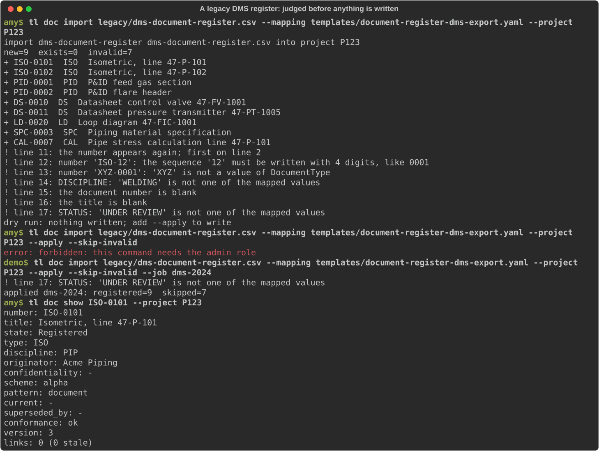

**Reproduce:** `uv run tl doc import dev/seed/legacy/dms-document-register.csv --mapping dev/seed/templates/document-register-dms-export.yaml --project P123` (preview), then `--apply --skip-invalid --job dms-2024` as an admin or a document controller.

**Standard activity.** The old register is exported to a spreadsheet and loaded by script or by hand; rows with bad numbers or odd statuses are fixed in the spreadsheet, or dropped without anyone noticing, and the load leaves no trace of where the rows came from.

**Novel approach.** The file is judged against the live numbering pattern, the code lists and the command's own limits before anything is written. Every refused row says which line and why (`ISO-12: the sequence '12' must be written with 4 digits`, `'XYZ' is not a value of DocumentType`, `the title is blank`), applying is one unit of work, and the job's name is in the history of every document it created. The sample imports 9 documents and refuses 7 rows (P1-I2).

**Unique value.** A migration whose rejects are a to-do list rather than a surprise, with provenance on everything it wrote. Honest limits: this import registers documents; revisions with files and issue dates from a legacy register are a later loader (P1-I8), so imported documents show `current: -`.

## 13. What a plain user cannot do

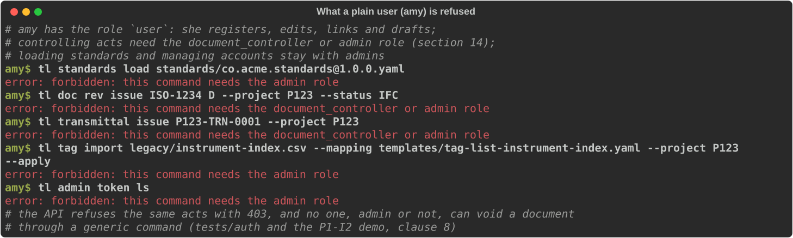

**Reproduce:** run any of the commands in the screenshot as a user with the role `user` (`uv run tl login amy`).

**Standard activity.** Who may issue a drawing or apply a bulk load is a convention written in a procedure; the tool lets any editor do it, and an audit finds out afterwards.

**Novel approach.** Every command and API route is checked against the signed-in role before it runs, with closed-by-default rules for agents (a new route or MCP tool is denied until someone allows it). The refusal is one fixed sentence that names the roles that would do: `forbidden: this command needs the admin role` for accounts and the registry, `forbidden: this command needs the document_controller or admin role` for the controlling acts of document control. The same acts are refused over HTTP, and no one, an admin included, can change a document through the generic record commands: documents change only through the module's own commands (the P1-I2 demo, clause 8; `tests/auth`).

**Unique value.** The separation between drafting and controlling is enforced by the system, so a procedure is not the only thing standing between a draft and the field. Honest limits: the lines are `user`, `document_controller` and `admin`, company-wide, with no per-project or per-record grants (section 14 says what the controller role can and cannot do). Confidentiality (who may read a record) is recorded and not enforced, and there are no per-record access lists in Phase 1.

## 14. The document controller role

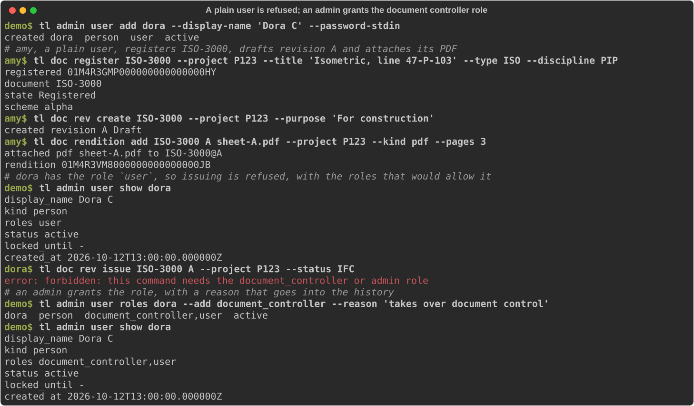

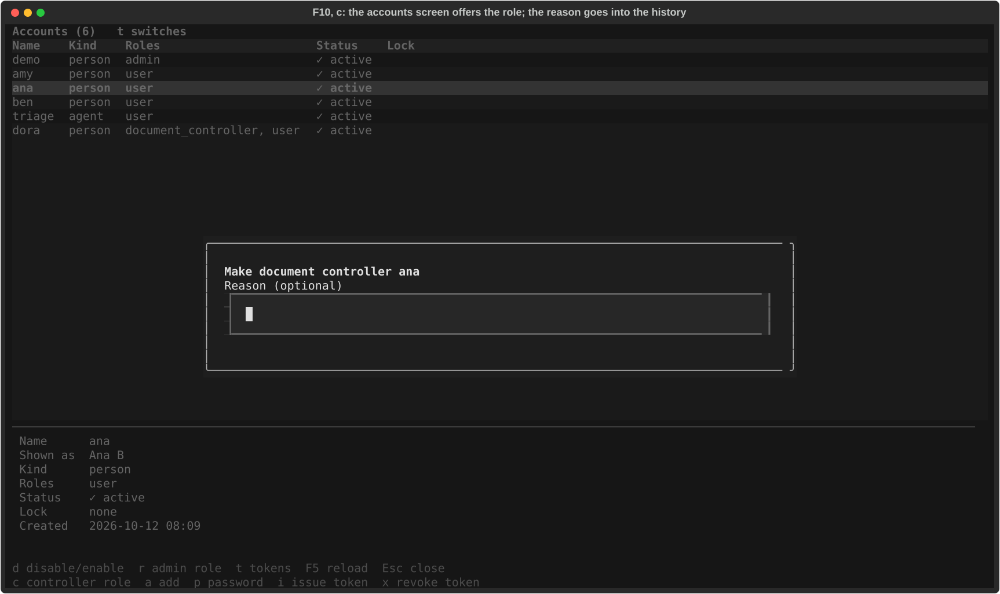

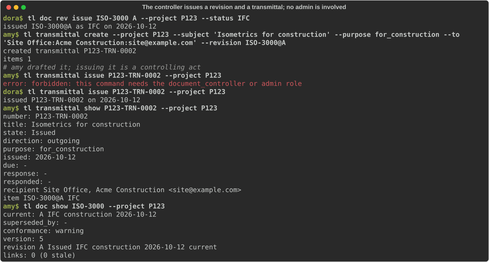

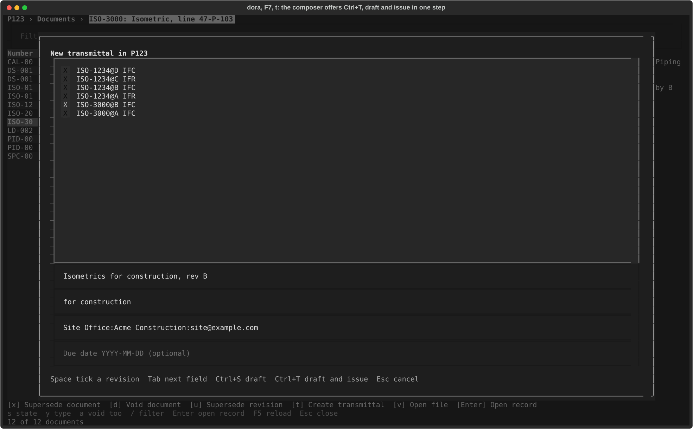

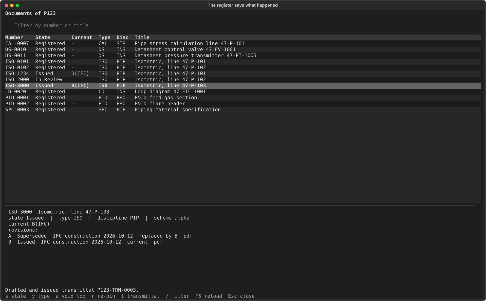

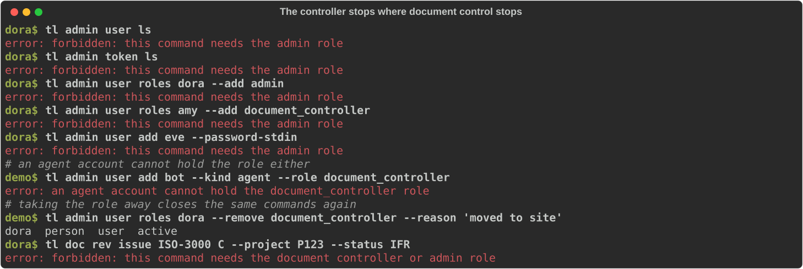

**Reproduce:** as an admin `uv run tl admin user roles dora --add document_controller --reason "takes over document control"` (or `F10`, highlight the person, `c`), then `tl admin user show dora`; as `dora` `uv run tl doc rev issue ISO-3000 A --project P123 --status IFC` and `tl transmittal issue P123-TRN-0002 --project P123`; in the TUI `F7`, `t`, `Ctrl+T`; `tl admin user roles dora --remove document_controller` takes it away. `just demo P1-I2b` runs the whole clause list on SQLite and PostgreSQL. Runbook: `docs/runbooks/accounts-and-access.md`.

**Standard activity.** A document controller is the person who issues drawings for construction and sends the transmittals. In most systems that means a super-user: the role that can issue is the role that can also create accounts, change permissions and edit the master data, because the product has nothing between "editor" and "administrator". Or the controller is a clerk who prepares everything and waits for an administrator to press the button.

**Novel approach.** The controller is a role of its own, not "make her an admin". An admin grants it (a ledger event with the admin and the reason; it takes effect on her open session at once) and takes it away the same way. The commands it unlocks are an explicit, typed list: issue, supersede or void a revision or document, set confidentiality, register or replace a signed copy, issue a transmittal, record or override a review outcome on someone's behalf, and apply a document import. Anything not on the list is an admin's, so a typo or a command added later closes a door instead of opening one (ADR-0013). The ledger names the person who did it (`user:dora`), not an admin acting for her. A plain user's refusal names the roles that would do: `needs the document_controller or admin role`. The accounts screen offers the role to admins with `c`; a controller's document register offers `Ctrl+T` in the transmittal composer, which drafts and issues in one step, and the TUI only offers it: the same service gate answers. In the screenshots `dora` cannot list accounts or tokens, change any role (her own included), create an account, or load standards; an agent account cannot hold the role at all, and agents have no part in the controlling acts (P1-I2b, [report](P1-I2b.md)).

**Unique value.** The person who controls the documents does not also hold the keys to accounts, tokens and the engineering registry, and "who issued this revision, and were they allowed to" has a ledger answer with a named person. Honest limits, all from ADR-0013: the role is company-wide (there is no per-project assignment, so a controller controls every project of the ledger); there is no separation of duties (a controller may issue a revision she drafted, and may record or override review answers); the simulator does not issue (its people sign in with development tokens that carry the `user` role only); there are no per-record access lists (confidentiality has been enforced since P1-I5, section 17). A fresh-context security review of the role found no high or medium issue, and its four low findings were fixed with tests before the merge ([P1-I2b report](P1-I2b.md)).

## 15. The derivation pipeline

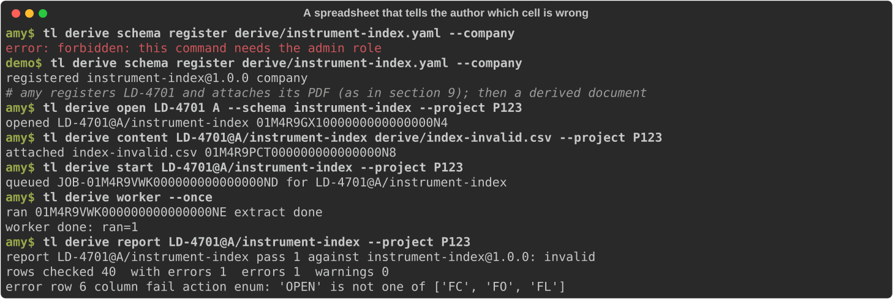

An admin registers the `instrument-index` schema once for the company, and a plain user is refused. Amy opens a derived document on revision A of the instrument index `LD-4701`, attaches a spreadsheet with one wrong cell and starts it; the worker reads the file in a child process under a resource limit. The report says where the fault is: row 6, column `fail_action`, `OPEN` is not one of FC, FO, FL.

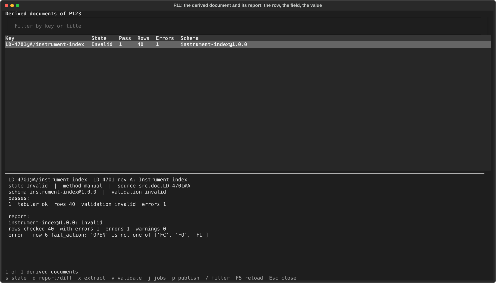

`F11` lists the derived documents of the project. The same report is on the screen: state Invalid, 40 rows checked, one error, and the source `src.doc.LD-4701@A` that every later record will carry. Nothing has been created in the register yet.

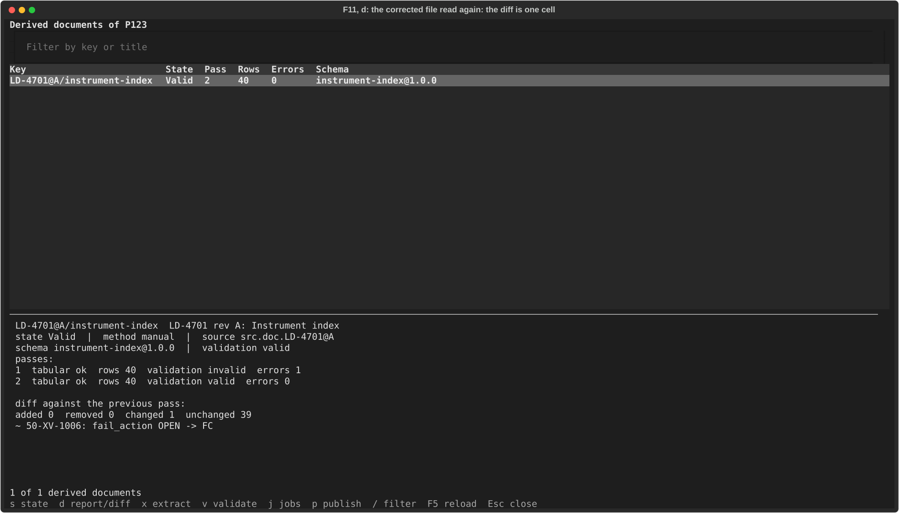

Amy attaches the corrected file and the worker reads it again as pass 2, which is Valid. Pressing `d` toggles the report for the diff against the pass before: one cell changed (`fail_action` of `50-XV-1006`, OPEN to FC) and 39 rows unchanged. A reviewer approves one cell, not forty rows.

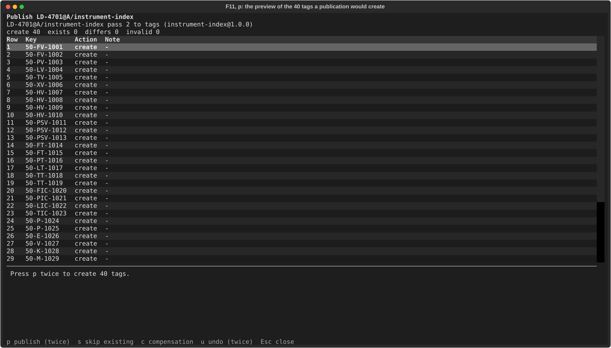

`p` opens the publish preview: 40 tags would be created, none exists yet, none differs, none is invalid. The screen asks for `p` twice before it writes anything, and `s` would skip tags that already exist.

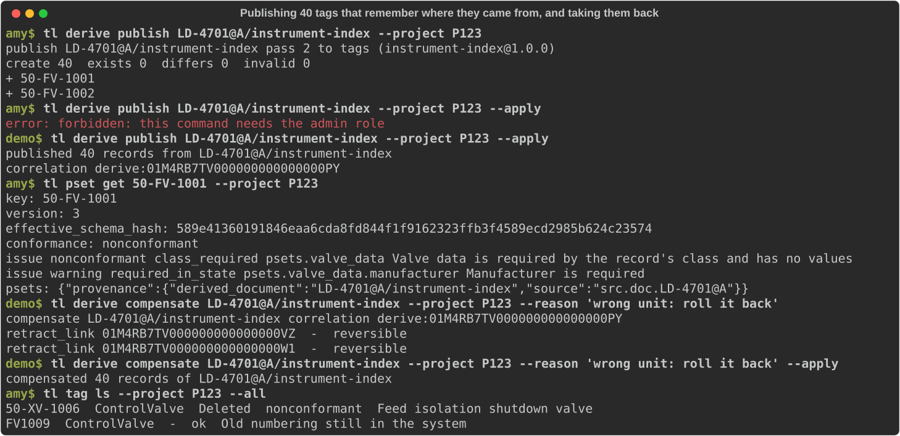

The preview works for a plain user, but applying it is refused. The admin publishes 40 tags, and each carries `provenance` naming the source document and the derived document. Compensation takes back exactly the ids the publication recorded, with a reason; the tags end as Deleted and the ledger keeps every original event.

**Reproduce:** `just demo P1-I3` runs the whole clause list on SQLite and PostgreSQL. By hand: `uv run tl derive schema register instrument-index.yaml --company`, `tl derive open LD-4701 A --schema instrument-index --project P123`, `tl derive content LD-4701@A/instrument-index file.csv --project P123`, `tl derive start ...`, `tl derive worker --once`, `tl derive report ...`, `tl derive diff ... --rev 2`, `tl derive publish ... [--apply]`, `tl derive compensate ... --reason "..."`; in the TUI `F11`, then `d`, `j` (jobs), `p`, `u`. The tour renumbers the sample index to areas 50, 30 and 40 because section 8 already created `47-FV-1001`.

**Standard activity.** A spreadsheet from a vendor or a design office is loaded by hand into the tag register, and its mistakes are found one by one afterwards. **Novel approach.** The check is a registered, versioned JSON Schema applied to the stored rows, publication is one correlated import through the module's own commands, and an undo reverses exactly what it made (P1-I3, ADR-0014; [report](P1-I3.md)). **Honest limits.** PDF content is not extracted (the `pdf` extractor records properties only, ADR-0008 decision 8); a user cannot publish, a document controller publishes documents and an admin publishes tags; an agent can only propose an import (not shown here, section 4 shows the pattern).

## 16. Schedules and cost

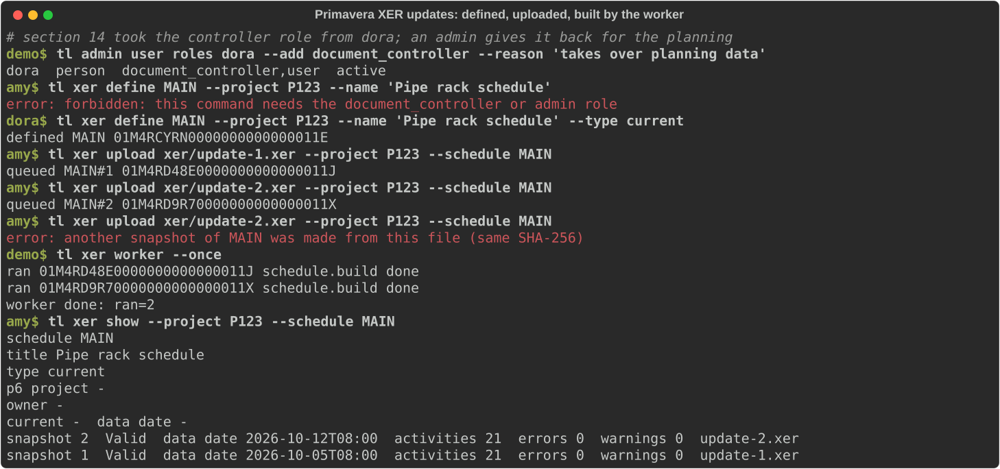

Section 14 took the controller role from Dora, so an admin first gives it back. A plain user cannot define a schedule; Dora does, and Amy uploads two weekly Primavera XER updates. The same file twice is refused by its SHA-256, and the worker builds both snapshots: Valid, 21 activities, no errors. The XER files are synthetic (`tl_xer.synth`), not a real project.

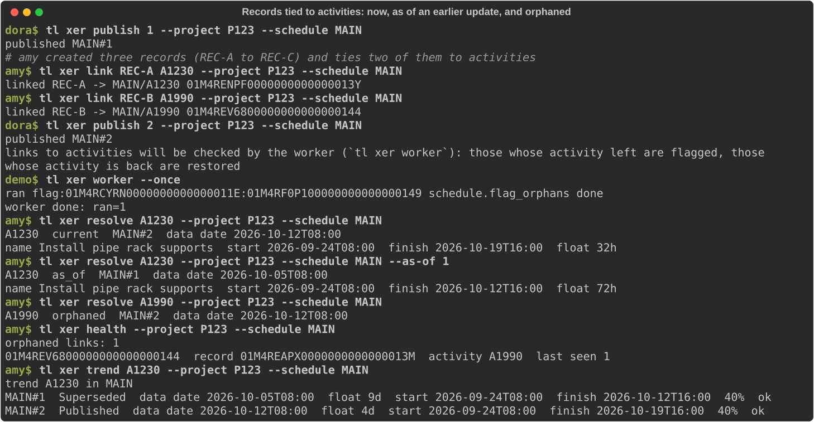

The controller publishes snapshot 1, Amy ties two records to activities, and snapshot 2 is published. `A1230` resolves to snapshot 2 now (float 32 hours) and to snapshot 1 when asked as of 1 (72 hours). `A1990` left the schedule in snapshot 2, so the record tied to it is flagged orphaned, and the trend shows `A1230` losing five days of float.

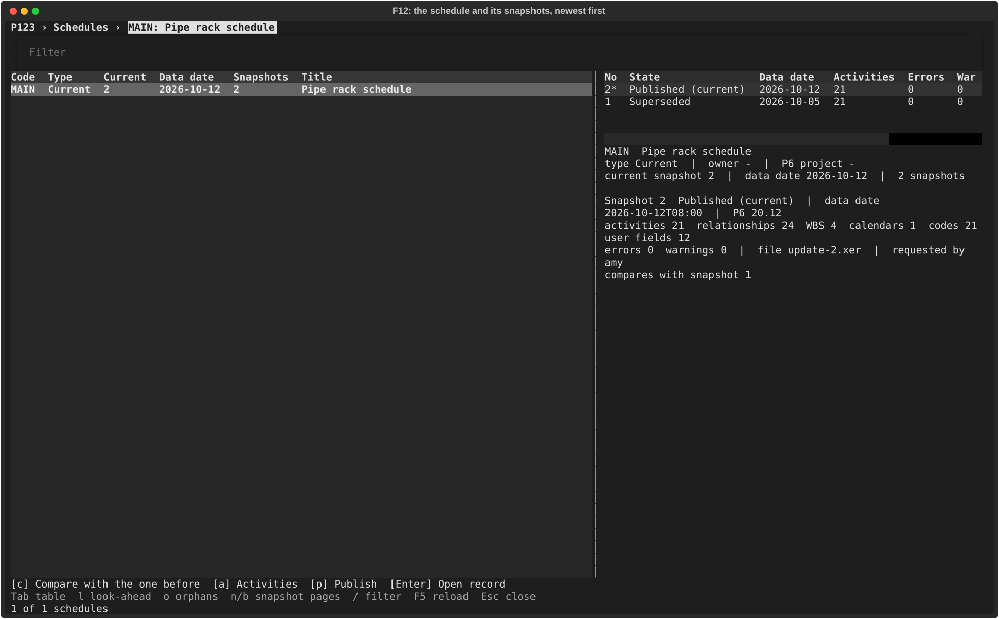

`F12` is the same data in the terminal: the schedule, its snapshots with data date, activity count and errors, and which one is current. The line under the detail says which snapshot the highlighted one compares with.

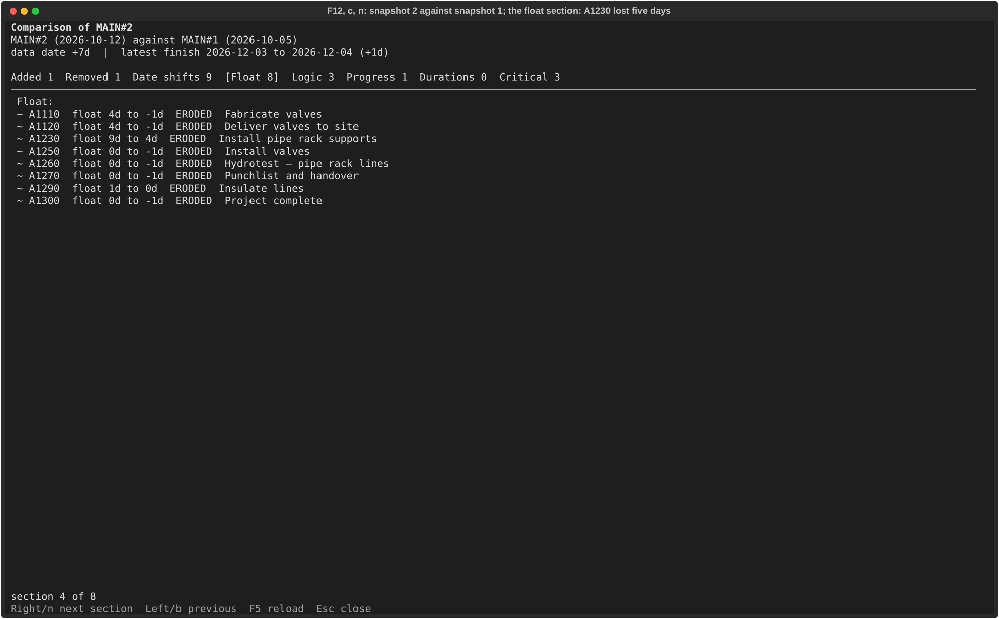

`c` compares the highlighted snapshot with the one before. The header counts the changes (one activity added, one removed, nine date shifts, eight float changes, three logic changes, three critical-path changes) and the float section lists the eight activities that lost float; `A1230` went from 9 days to 4.

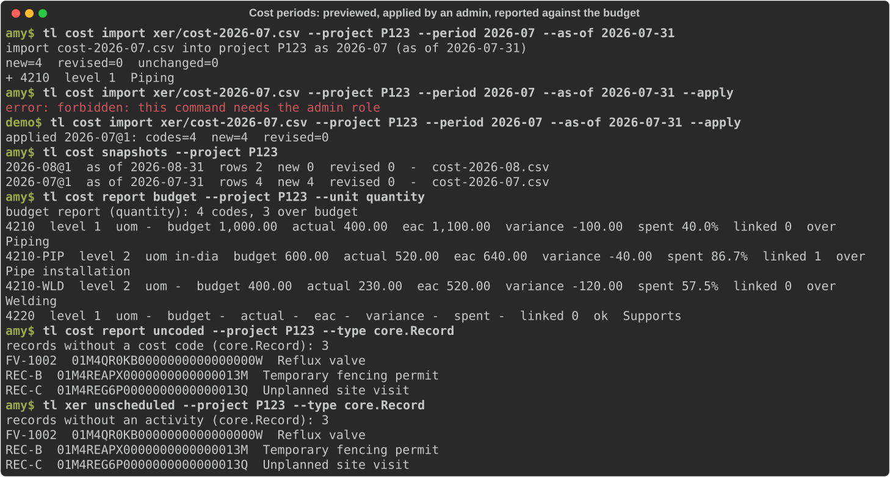

A cost period is previewed by anyone signed in and applied only by an admin; two periods are applied here. The budget report says three of four cost codes are forecast over budget, with the linked record count per code. Two reports list the records that have no cost code and no live activity link.

**Reproduce:** `just demo P1-I4`. By hand: `uv run tl xer define MAIN --project P123 --name "Pipe rack schedule"`, `tl xer upload update-1.xer --project P123 --schedule MAIN`, `tl xer worker --once`, `tl xer publish 1 ...`, `tl xer link REC-A A1230 ...`, `tl xer resolve A1230 ... --as-of 1`, `tl xer compare ... --new 2 --old 1`, `tl cost import file.csv --project P123 --period 2026-07 --as-of 2026-07-31 [--apply]`, `tl cost report budget ...`; in the TUI `F12`, then `c`, `a` (activities), `l` (look-ahead), `o` (orphans).

**Standard activity.** The planner emails a new P6 export, someone opens both in P6 to see what moved, and records refer to activities by a number that may not survive the next update. **Novel approach.** Each upload is an immutable, validated snapshot; a record links to an activity by its stable id and resolves to the current snapshot or an earlier one; the comparison is computed from the typed rows (P1-I4, ADR-0015; [report](P1-I4.md)). **Honest limits.** Only P6 XER is read; resource assignments and baselines inside a file are kept in the raw bundle only; applying a cost import needs the admin role and there is no separate cost role.

## 17. Correspondence, triage, clocks, threads and confidentiality

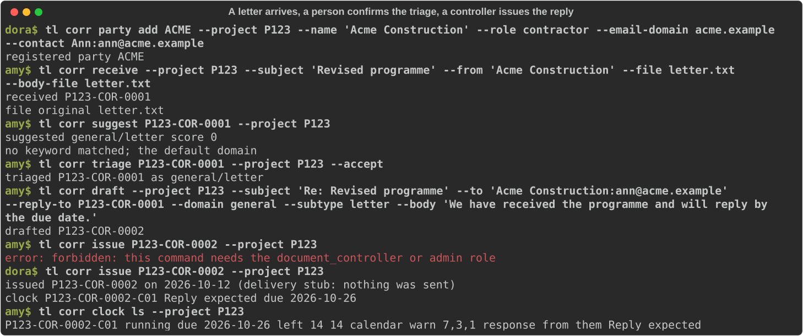

Dora registers the contractor as a party. Amy receives a letter by upload; the engine suggests the General domain and she confirms it. She drafts the reply, and issuing it is refused to her because it is a controlling act. Dora issues it (the send is a stub, nothing leaves the machine), which starts a 14-calendar-day clock with warnings at 7, 3 and 1 days.

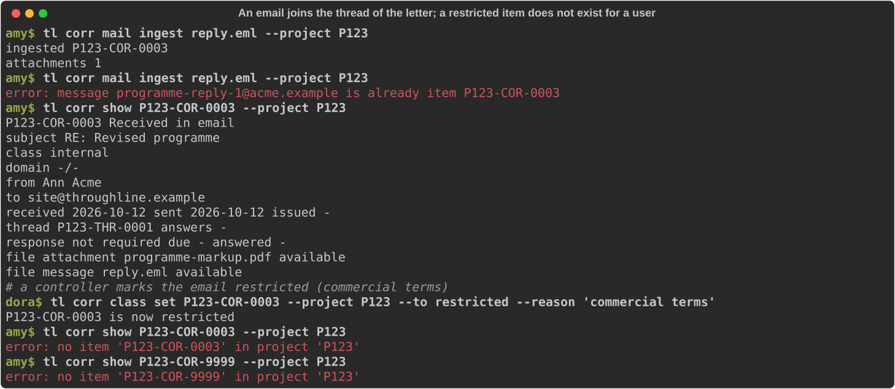

Amy reads in an email: the sender's domain finds the party, the subject puts it on the thread of the letter, and the PDF attachment and the original message are kept. Reading the same message again is refused. A controller then marks it restricted, and for Amy the item answers `no item`, word for word as the invented number `P123-COR-9999` does, so she cannot learn that it exists.

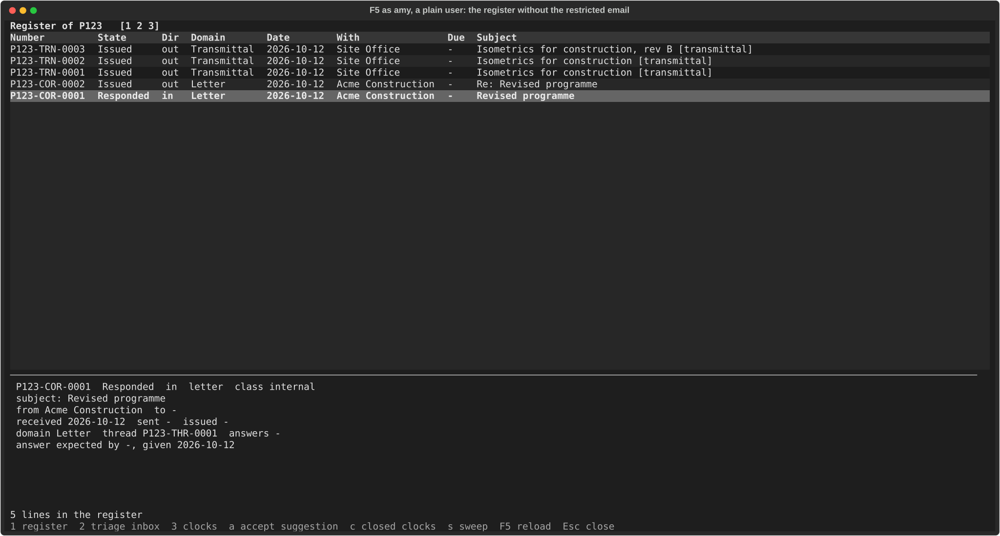

Amy's `F5` master register has five lines: the two letters and the three transmittals of document control (sections 11 and 14). The restricted email is not among them, and nothing on the screen says that a line was left out.

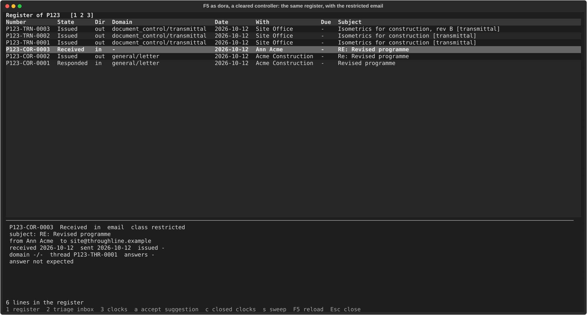

Dora's register is the same screen over the same ledger, with six lines: the restricted email is there, highlighted, and its detail says `class restricted`. The filter is applied where the data is read, so the API, the MCP tools, the exports and the feed answer the same way.

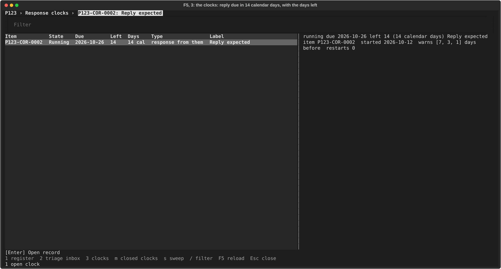

Key `3` turns the screen into the clocks of the project. The reply clock is running, due in 14 calendar days, and the warning days are shown; the clock's id and its calendar (`P123-default@1`) show only with technical details on (`Ctrl+D`, admins). A working-day clock skips weekends.

**Reproduce:** `just demo P1-I5`. By hand: `uv run tl corr receive --project P123 --subject "Revised programme" --from "Acme Construction" --file letter.txt`, `tl corr suggest <no> ...`, `tl corr triage <no> --accept`, `tl corr draft ...`, `tl corr issue <no>` (a controller), `tl corr clock ls`, `tl corr mail ingest reply.eml`, `tl corr class set <no> --to restricted --reason "..."`; in the TUI `F5`, then `1` register, `2` triage inbox, `3` clocks.

**Standard activity.** Letters sit in a shared mailbox and a spreadsheet, the response date is somebody's calendar entry, and who may read the commercial ones is a matter of folder permissions. **Novel approach.** One register covers letters, emails and transmittals; a clock is a record with a calendar, warnings and a reason it closed; confidentiality is a class on the item that every read path filters through one viewer (P1-I5, ADR-0016, [report](P1-I5.md)). **Honest limits.** Three classes and three roles, no per-record access lists beyond naming people on a privileged item; sending is a stub; the triage engine is keyword rules, and an agent only proposes triage.

## 18. RFIs and commercial notices

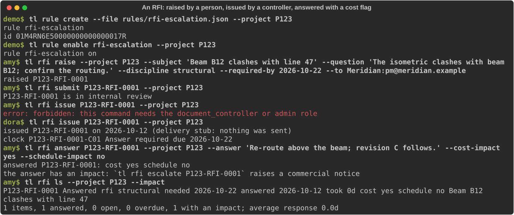

An admin installs the escalation rule. Amy raises an RFI about a clash between a beam and a pipe and sends it for internal review; issuing it is refused to her. Dora issues it, which starts an "answer required" clock. Amy answers with cost impact yes and schedule impact no, and the RFI log shows the response time and the flag.

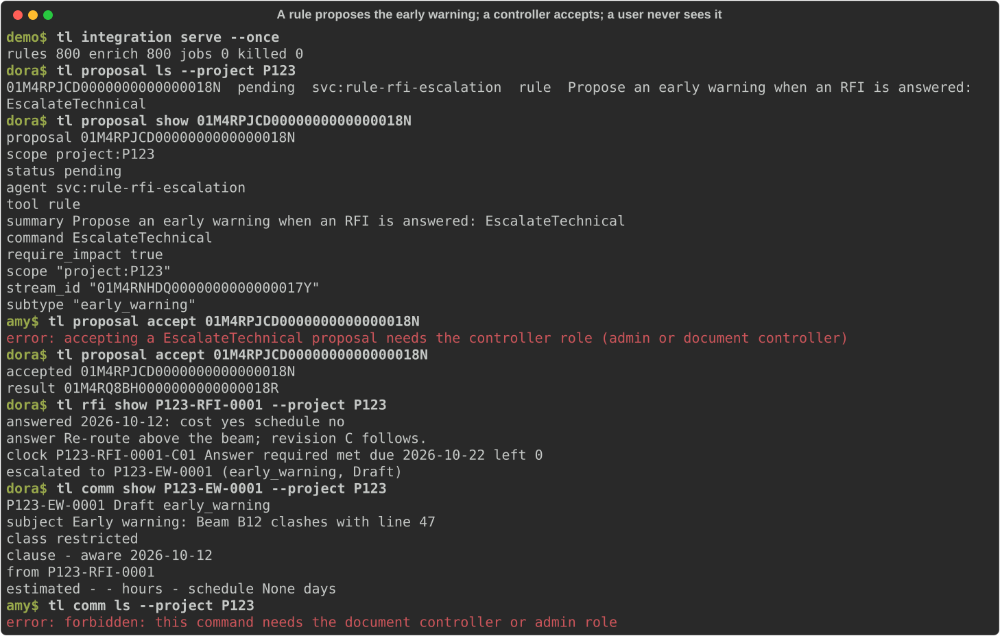

The rule watches for an answered RFI with an impact and proposes an early warning; it does not act by itself. The proposal shows the command it carries. Amy cannot accept it (it needs the controller role), Dora does, and the RFI now says it was escalated to `P123-EW-0001`, a restricted Draft whose time bar counts from the answer. Amy is refused the Commercial list altogether.

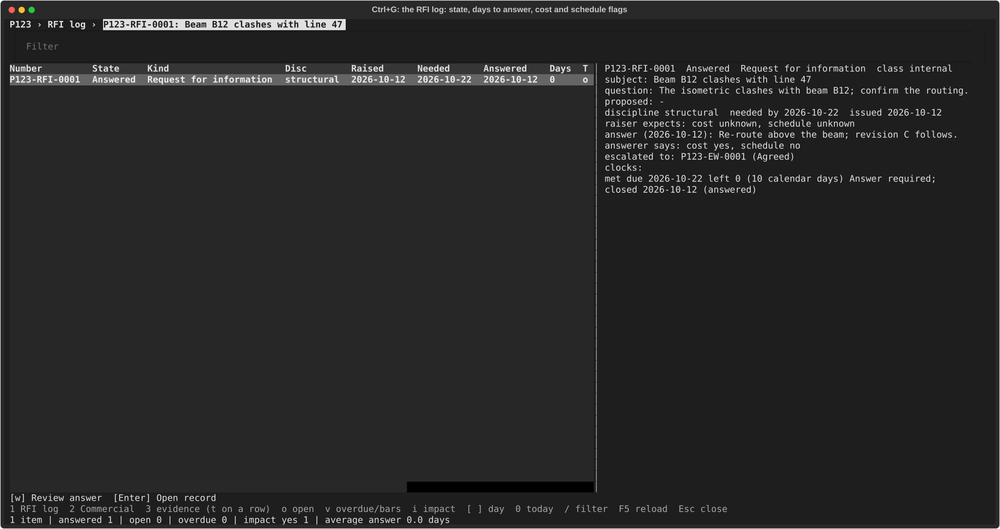

`Ctrl+G` opens the RFI log as Dora. The answered RFI shows 0 days to answer, on time, cost yes and schedule no, and its detail names the notice it was escalated to and the clock that was met.

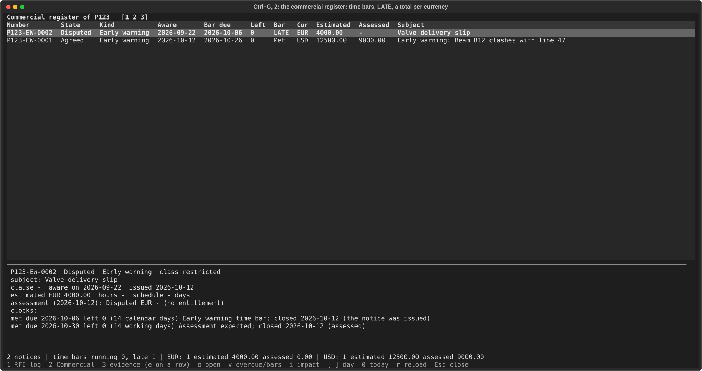

Behind the screen the controller priced and issued the first notice, raised a second one that became aware of the problem 20 days ago, and assessed both. The register shows the first notice's time bar met, the second marked LATE, and the totals in USD and EUR on separate lines, never added.

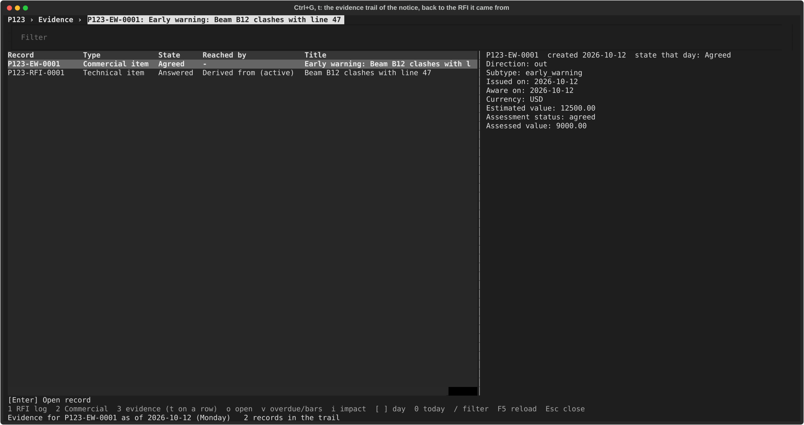

`t` on a notice opens its evidence trail: the notice, the RFI it is derived from, and the state of each as of the chosen day. `[` and `]` step the day back and forward, so the screen can show what the ledger knew on any earlier day.

**Reproduce:** `just demo P1-I6`. By hand: `uv run tl rule create --file dev/seed/rules/rfi-escalation.json --project P123` and `tl rule enable rfi-escalation --project P123`; `tl rfi raise ...`, `tl rfi submit <no>`, `tl rfi issue <no>` (a controller), `tl rfi answer <no> --answer "..." --cost-impact yes --schedule-impact no`; `tl integration serve --once`; `tl proposal ls`, `tl proposal accept <id>` (a controller); `tl comm ls --time-bars`, `tl evidence P123-EW-0001`; in the TUI `Ctrl+G`, then `1`, `2`, `3` or `t`.

**Standard activity.** An RFI log is a spreadsheet, a claim notice is a letter from the commercial manager, and the link between the two lives in somebody's head until a dispute. **Novel approach.** The answer carries its cost and schedule impact as data, a rule turns an impactful answer into a proposed notice that a controller decides, the notice's time bar is a clock like any other, and the trail between them is a link that the ledger can replay for any past day (P1-I6, [report](P1-I6.md)). **Honest limits.** The delivery of an issued RFI or notice is a stub; the rule only proposes; the Commercial items are all controller acts and restricted by default.

## 19. The integration layer and record threads

An admin registers a contractor's app and an endpoint with a mapping and an allow-list of commands; the signing secret is shown once and is hidden here. The dry run shows the commands the mapping would produce from a sample payload. Switched to live, a signed post is accepted (202), the same message again and an unsigned post are refused (401), and the worker then applies the delivery, and the valve record carries the contractor's tag number and manufacturer. The endpoint acts as its own service actor, so the history names it and not a person.

A rule is data. Its dry run over the recent events says what it would have done (one firing), and only then is it switched to act. The next safety post gets a reply from `svc:rule-hse-notify`. A keyword classifier is then registered; it will only propose.

`Ctrl+E` is the registry of everything the layer can do: endpoints, rules, actions, enrichers, apps, invocations and the error queue, one table at a time (`1` to `7`). The endpoint's detail shows who it acts as, what it may run, the body cap and the rate limit. The kill switch is shown at the top.

A new document was registered and the classifier proposed its type and discipline. Nothing is written to the document's own fields: the values wait in the review queue with the enricher's name and a confidence, until a person accepts (`a`) or rejects (`x`) them.

Threads were switched on by an admin, and a thread hangs on every plain record. The thread tab shows Amy's message and the result card of an earlier `/raise record`. Typing `/link #V-1002 as requires` and pressing Enter does not run it: the panel lists the command it would run and the access it needs, and a second Enter confirms exactly that plan.

**Reproduce:** `just demo P1-I7` (integration layer) and `just demo P1-I7B` (threads). By hand: `uv run tl integration app add acme-nde --label "Acme NDE" --project P123`, `tl endpoint create acme-nde/results --mapping-file map.jsonata --allow SetPsetValues --project P123`, `tl delivery dry-run ... --sample payload.json`, `tl endpoint mode ... live --reason "..."`, `tl endpoint enable ...`, `tl integration serve --once`; `tl rule create --file hse.json`, `tl rule dry-run hse-notify`, `tl rule mode hse-notify act --reason "..."`; `tl enricher register doc_classifier --file enricher.json`, `tl enrich ls`; `tl thread preview --project P123 V-1001 "/link #V-1002 as requires"`; in the TUI `Ctrl+E`, `Ctrl+R`, or `T` and `c` on a record.

**Standard activity.** A vendor's results are keyed in by hand or pasted from an email, "when X happens, tell Y" is somebody's habit, and a conversation about a record lives in a chat tool that the record does not know about. **Novel approach.** Everything automated acts as its own named service actor with a declared access, starts in a dry-run or propose mode, is bounded in depth and steps, and is stopped by one kill switch; a thread is part of the record, and a slash command in it is previewed and then run as the person who typed it (P1-I7, ADR-0017, ADR-0018; [report A](P1-I7-A.md), [report B](P1-I7-B.md)). **Honest limits.** The signed outbound action (`tl action define` and `invoke`, with a receiver that verifies the signature) and the `/dispatch` of such an action need a loopback receiver and are shown in `just demo P1-I7`, not in this tour; the `/assign`, `/due`, `/hold` and `/release` commands answer "unavailable"; the one enricher is a keyword table, not a model.

## 20. Schema registry and workbench

Amy drafts `co.acme.engineering@3.3.0` from a YAML file, with a changelog. `analyse` compares it with the version below and finds one added optional property (`actuator_make`): class **additive**, so it can be adopted without ceremony and does not block submit. She submits it for review; approving it is refused to her (an approval needs the admin role, and the module also refuses an approver who wrote or submitted the version). The admin approves it with a comment and publishes it. A second draft, by the admin, retypes `size_in` from decimal to integer: analysis calls it **breaking**, and submit is refused with the path and the reason.

`Ctrl+O` opens the schema workbench as the admin. The table lists every version of every package, newest on top, with its state, class and author; under it the highlighted version's properties, code lists and property sets. Nothing here edits the package: the workbench reads, and every step of the review is one command as the signed-in person. Without Ctrl+D it names people (`demo`, not `user:demo`), record types by title (`applies to Record`) and a property as its set and name (`Valve data: size in`); Ctrl+D brings the keys back.

Key `3` (or `[` and `]`) turns the panel into the diff against the version below; `2` shows the lint findings. Scrolled to the hunk that matters, the diff shows `actuator_make` added to `valve_data`; the other lines are only the stored form of the package (defaults written out).

`v` opens the review of the highlighted version. Classification lists each change with its class (the retyped `size_in` is breaking, the dropped `actuator_make` a deprecation). The impact report says what the change would touch: the 9 records that hold a `size_in` value (they would be checked again against the new definition), a column that changes type, generated views, two reports and the input schema of the MCP tools. It has a digest, so a later pin can say which report the person read.

`t` tries the version on a sample of the records the viewer may read (229 checked, none newly nonconformant). `s` submits, and the module's refusal is shown in the status line and changes nothing. The same screen approves (`y`), sends back (`c`) and publishes (`p`, which asks for the word `publish` to be typed).

The impact report can be made for a project (`--project P999`); its digest is what an admin may pass to `tl schema adopt` to say which report they read. Amy cannot adopt. The admin pins P999 to 3.3.0, and `tl schema adoptions` lists the pin with the version it came from, its class and who made it.

**Reproduce:** `just demo P1-I8` (clauses 1 and 2). By hand: `uv run tl schema package draft pkg.yaml --changelog "..."`, `tl schema package analyse|classify|diff|impact|test <package>@<version>`, `submit`, `approve --comment "..."`, `publish`; `tl schema adopt <project> <package> <version> [--impact-sha256 <digest>]`, `tl schema adoptions`; in the TUI `Ctrl+O`, then `1` to `3`, `v`, `a`, `t`, `i`, `s`, `y`, `c`, `p`.

**Standard activity.** A change to a company standard is a Word or Excel file sent round for comment; nobody can say which projects it breaks until one of them fails, and "which version are we on" is a question for the person who last copied the file. **Novel approach.** The standard is a versioned package with a lifecycle (Draft, InReview, Approved, Published, Deprecated, Retired); every draft is classified by the same engine that publishes it (additive, constraining, deprecation, breaking), an impact report lists records, columns, views, mappings, reports and MCP schemas it touches, the approver can never be the author, and each project pins a version and sees when it is behind (P1-I8, [report](P1-I8.md); runbook `docs/runbooks/schema-package-change.md`). **Honest limits.** The workbench has no property editor yet (a draft is a file); no value-list or crosswalk editor; stewards and data managers are admins today; promoting a project's rule to the company (`tl schema promote`) and the MCP schema tools are follow-ups.

## 21. Waivers, conformance dashboard, crosswalk, export and import

When a project cannot meet a rule for a while, the escape hatch is a waiver of one property, with a reason and an end date, not a switched-off rule. Amy asks for a 30-day waiver of `psets.valve_data.size_in` on P999 and cannot approve it herself; the admin does, and the list shows it `Approved until` that day. The dashboard for the project carries it as a live waiver with the days left. The admin then revokes it with a reason, and the list shows `Revoked`. Approved, unexpired waivers reach the evaluator through the effective schema, and a waived case is counted in its own field, never as conformant.

`tl schema conformance --project P123` counts the project's records by type as the person who asks: total, ok, warning, nonconformant, waived and stale, and says that the project is behind the company on `co.acme.engineering` (3.2.0 against 3.3.0). A record the reader may not read is not counted. The crosswalk beneath it shows how the project's own code for a valve body material (`SS316L-NACE`) maps to the company code (`SS316L`).

`tl schema export-git DIR` writes the published and deprecated package texts to files, ready for a git repository; the second run says `unchanged`. A plain user is refused. `import-git --dry-run` reports what it would draft; a file edited by hand makes the real import print the problem and stop (all files are checked first and nothing is drafted); a file that imports is always a draft that goes through review, never a published version.

**Reproduce:** `just demo P1-I8` (clauses 3 and 4). By hand: `uv run tl schema waiver request P999 psets.valve_data.size_in --reason "..." --expires 2026-11-11`, `tl schema waiver approve|revoke <key>`, `tl schema waiver ls --project P999`; `tl schema conformance --project P123 [--json]`; `tl schema crosswalk --project P123`; `tl schema export-git DIR`, `tl schema import-git DIR [--dry-run]`.

**Standard activity.** An exception to a standard is an email from the project manager that lives in an inbox; conformance is a quarterly audit run on a sample; the list of code mappings between a project and the company is a spreadsheet one person maintains. **Novel approach.** A waiver is a record with an approver, a reason, an expiry and a history; the dashboard counts every record on every read, with waived cases apart; the crosswalk is read from the schemas themselves; and the standard can leave the system as text in git and come back only as reviewed drafts (P1-I8, [report](P1-I8.md)). **Honest limits.** P123 declares the strict conformance mode, where waivers have no effect, so the tour waives on P999; the crosswalk and the dashboard are commands, not TUI or API views yet; export is admin only and holds package text, never project data; limits for the dashboard on very large projects are a follow-up.

## 22. Legacy loads and lake marts

An admin keeps a CSV register of a former system as a **load run** (`dms/register#1`) with the `dms-register` loader: `extract` reads it (3 rows, 11 columns), `profile` describes its columns, and `plan` says what a load would do, `new 3 existing 0 invalid 0`, without writing a document. A plain user is refused. After `tl lake sync`, the document mart shows P123's counts by discipline, type and status before the load.

`load --expect-new 2` is refused because the plan said 3; `--expect-new 3` loads them in one transaction, and `reconcile` compares the file with the records (3 matched, 0 mismatches). A second file with one restricted document is loaded as a restricted run. The lake is built for the lowest reader, so after the next sync the mart counts three more documents (isometrics from 3 to 5 in the unissued row, P&IDs from 2 to 3) and the restricted `PRC-0001`, in the register for the admin, is in no row of the mart, for the admin or for anybody else.

A wrong load is taken back with `tl load compensate`, which ends exactly the records the run created, in one transaction, and refuses (naming each record) if one was changed since. The documents are `Void`, a sync brings the mart back to its first counts, and a new plan of the same file says `new 0 existing 3`: the numbers stay in the ledger, voided.

**Reproduce:** `just demo P1-I8` (clauses 5 and 6). By hand: `uv run tl load open register.csv --project P123 --loader dms-register`, `tl load extract|profile|plan <run> --project P123`, `tl load load <run> --project P123 --expect-new 3`, `tl load reconcile <run> --project P123`, `tl load compensate <run> --project P123 --reason "..."`; `tl lake sync`, `tl lake mart ls`, `tl lake mart show mart_document_status`.

**Standard activity.** A migration is a one-off script run on a Friday night by a contractor, the first sign of a problem is a project engineer finding a missing document, and "undo" is a restore from backup. **Novel approach.** The file is kept as an immutable run with a profile, the plan is a dry run that names the new, existing and invalid rows, the load must be told the number it expects, every created record carries the run as its correlation, reconcile proves the result against the file, and compensate is a new event, not a rewrite; the analytics copy never holds a row the lowest reader may not read (P1-I8, ADR-0016, [report](P1-I8.md); runbooks `legacy-load.md` and `lake-sync.md`). **Honest limits.** Three loaders (`dms-register`, `instrument-index`, `equipment-list`); no line-list loader, because piping lines are not a tag class in the company standards; `TagTarget` ignores the run's class (tags carry none); the reconciliation report is a file of the run and not a registered document; the lake marts are for the lowest reader only.

## 23. Plain language and the record screen

Enter on a row of any register opens the **full record**: Details (the module's own fields), Properties, Links, History, Trace and Thread, and Esc returns to the same row. The screens say `Control valve`, `Document data` and `Contract clause`; they do not show record or event ids, hashes, schema versions, internal keys, clock or calendar ids, or the rule markers of the property sets (`required at Design`, not a code). Three example property sets of the company standard, `document_data`, `rfi_data` and `correspondence_data`, carry values on records the earlier sections made (`ISO-1234`, `P123-RFI-0001`, `P123-COR-0001`), set with `tl pset set`; the tour checks every screenshot for technical text and fails if one carries any.

**Technical details** are one key, `Ctrl+D`, offered to admins only: it adds what the plain screens hide (ids, versions, hashes, internal keys), and pressing it again hides them. It is off at the start of every session and a plain user who presses it gets one line, `Technical details are for admins`. The tour also looks for the record-type and property keys of the schema (`core.Record`, `valve_data.body_material`), as the plain-user walking test does. The one technical shot (`23f`) is the only one in this phase that the tour does not check for technical text.

**Reproduce:** `just demo P1-UX` (both backends; four clauses). By hand: `uv run tl pset set --project P123 ISO-1234 document_data originator="Acme Piping" native_format=DWG`, then open `tl tui`, press `F7`, `Enter`, `2`; as an admin press `Ctrl+D`.

**Standard activity.** A register is a list; the full record is another tool, and the property data sits in a spreadsheet beside it. Staff read internal codes (`PIP`, `ControlValve`, `general/letter`) and ids that mean nothing to them. **Novel approach.** One record screen serves every type, and its tabs read the same schema the forms and the checks use, so a document, a tag, an RFI and a letter show their sets alike; one shared helper turns codes, types, domains and rule markers into words, and the toggle brings the raw view back for those who need it (P1-UX). **Honest limits.** This is display only: the CLI, API and MCP keep their output. The three sets are examples in the fixture standard, not a model for a real company. The toggle is for admins and is not remembered between sessions. A value from a code list shows its label (`Structural`, `US dollar`); a money amount carries its currency code (`12500 USD`), taken from the currency property beside it; Ctrl+D shows the stored codes.

## 24. The log standard, the RFI record and document preview

Every log (documents, tags, letters, RFIs, notices, schedules, the review queue, the integration registry and the schema workbench) now has the same shape. A line at the top says where you are and which record you are on (`P123 › RFI log › P123-RFI-0002: Conflict in piling and utilities at AZ203`) and follows the highlighted row. The list carries plain words only. The selected record sits below the list, or to its right from 160 columns, and switches when the window is resized. Under it a bar lists the actions the viewer may take on that record in its state (`[a] Answer  [c] Close  [Enter] Open record`), each with its key; the keys row below it holds navigation and filters only. The bar comes from the service that owns the record, so nothing is offered that would be refused.

The bar differs by person and by state. The RFI awaiting an answer (24a) shows `[a] Answer`, which opens a small form and sends the existing answer command; once it is answered the bar offers `[w] Review answer` instead. The RFI waiting to be issued shows a plain user `Return to draft` and `Void` (24f), and a controller also `Issue` (24g). An agent account cannot open the TUI at all, so there is no "reader" screen.

The RFI record leads with what a person wants to read: subject, the question in full (it wraps, nothing is cut), the proposed solution, then the answer when there is one. A status timeline follows, oldest first, with the date, the person and the note: raised, submitted, issued, answered, the answer rejected with the reviewer's reason, reissued, issued again, and the clock outcome. The metadata comes last. The Files tab (key `6`, present only while the record has files) lists the attachments with kind, size and pages; the third file is the PDF the system made when the RFI was issued.

In the document log `v` (or Enter on the file line) opens the current revision's file in the system viewer: the file is fetched into a private temporary folder, its size and SHA-256 are checked, and the folder is removed when the screen closes. In a terminal that can show images the panel draws page 1 of a PDF as a picture; the tour's terminal cannot (it is run with `TL_IMAGES=off`, like the tests), so the panel gives the fallback: `PDF document  789 B  3 pages`. Rendering page 1 runs in a separate, resource-limited process off the screen's thread and is cached by the file's content hash.

**Reproduce:** `just demo P1-UX2` (both backends; four clauses). By hand: `uv run tl rfi raise ...`, `tl rfi submit|issue|answer|review|reissue <no>`, `tl file put sheet.pdf --project P123 --record <no> --slot attachment` (an RFI takes files only before it is submitted), `tl doc rendition add ISO-6100 A iso-6100.pdf --kind pdf`; in the TUI `Ctrl+G` then `Enter` and `6`, or `F7` and `v`. `TL_IMAGES` and `TL_VIEWER_CMD` are described in `docs/runbooks/tui-dev.md`.

**Standard activity.** A register is a list, the full record is another tool, the thread of who answered what lives in email, and a drawing is opened by finding it in the document system and downloading it. **Novel approach.** One log screen serves every register, so the place, the record and the next step are always in the same positions; the next steps come from the same rules the commands apply, the RFI record reads like the correspondence it replaces (question, answer, history, attachments), and a document can be opened or previewed from the row that names it.

## What Phase 1 did not do

- **No permission model beyond three company-wide roles.** Confidentiality is enforced by class (section 17) but there are no per-record access lists apart from naming people on a privileged item; recipient emails on transmittals and the "send" of letters, RFIs and notices are data and stubs. Stewards of the schema and data managers who run loads are admins today (section 20 to 22, [P1-I8](P1-I8.md)).
- **No single sign-on or MFA**, and no escalating lockout or lockout alert.
- **Real content extraction is partial.** The PDF extractor records properties only; OCR and content extraction of drawings are later work (section 15).
- **Only P6 XER** is read for schedules, and resource assignments and baselines inside a file are in the raw bundle only (section 16).
- **Automation proposes or runs as its own actor.** The signed outbound action and its receiver are shown by `just demo P1-I7` and the exit chain of `just demo P1-I8` (clause 7), not by this tour; four thread commands (`/assign`, `/due`, `/hold`, `/release`) answer "unavailable" (section 19).
- **The schema workbench reads and reviews; it does not edit.** There is no property editor, value-list editor or crosswalk editor in the TUI; a draft is a file. `tl schema promote` (taking a project's rule to the company, which needs read-time aliases, brief 27.5) and the MCP schema tools (brief 27.8) are follow-ups, and so are the crosswalk and the conformance dashboard as TUI or API views (section 20 and 21, [P1-I8 follow-ups](P1-I8.md#follow-ups)).
- **Loads and the lake marts have gaps.** `TagTarget` ignores the class of a run (tags carry no class) and needs a class of its own; there is no line-list loader; the reconciliation report is not a registered document; the marts are built for the lowest reader only (section 22).
- **Several domain modules are still to come:** quality, piping, work packaging, materials and the rest of the brief's modules.
- **No "newer revision in review" marker** on a healthy construction pin (ADR-0012, option C), and no revisions with files or issue dates in the legacy document import (section 12); the `dms-register` load of section 22 reads the same columns.
- **The tour itself ran on SQLite.** The PostgreSQL evidence in section 5 is stored from the P1-I0 report; the demos of each increment, including `just demo P1-I8`, run on both.

The reports behind each section are [P1-I0](P1-I0.md), [P1-I1](P1-I1.md), [P1-I2](P1-I2.md), [P1-I2b](P1-I2b.md), [P1-I3](P1-I3.md), [P1-I4](P1-I4.md), [P1-I5](P1-I5.md), [P1-I6](P1-I6.md), [P1-I7 A](P1-I7-A.md), [P1-I7 B](P1-I7-B.md) and [P1-I8](P1-I8.md); the Phase 0 core they build on is shown in [PHASE-0-TOUR.md](PHASE-0-TOUR.md).
